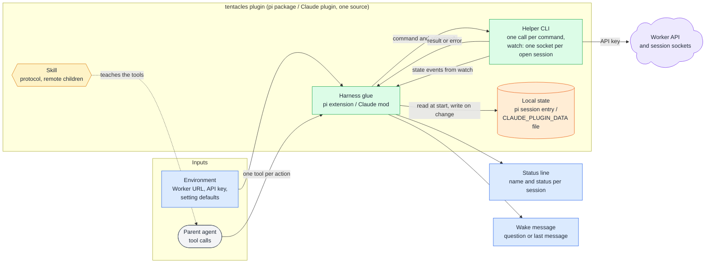
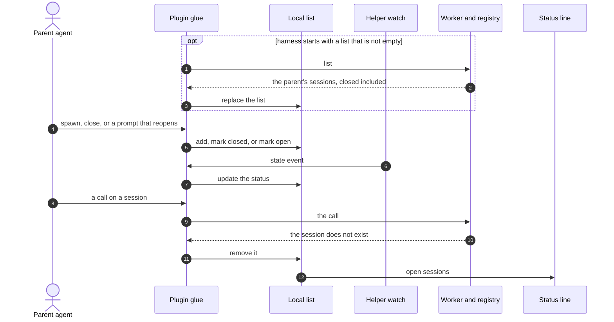
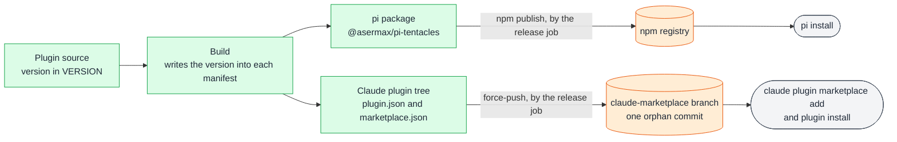

# Plugin

## 🔭 Overview

The tentacles plugin gives a parent agent on pi or Claude Code one tool per action on its remote sessions: spawn, prompt, messages, wait (pi only), list, close and answer. It is built from one source into a pi package, published to npm, and a Claude plugin, published as a Claude Code marketplace. Each tool call runs a bundled helper CLI that calls the [Worker API](worker-api.md), and a long-running watch holds one socket per open session to update the status line and wake the parent when a session asks, finishes or fails. The plugin keeps a local list of the parent's remote sessions per harness session and syncs it with the Worker when the harness starts. It reaches tentacles only through the Worker API and the session sockets.

## 🏗️ Architecture

The **harness glue** is a pi extension on pi and a Claude mod on Claude Code. It registers the tools, turns each tool call into a helper command, keeps the parent's local state, updates the status line and delivers the wakes.

The **helper CLI** runs as one process per command, and as a long-running watch that holds one socket per open session in the local state and hands each state change back to the glue. For spawn it also reads the skill, agent and context paths the agent passed, checks every file, and packs the skills, agents and context archives it sends (see [sessions](sessions.md)). It reads the Worker URL and the API key from environment variables, and the default session settings come from environment variables too (see Implementation details).

The **local state** is the parent's list of remote sessions, per harness session: a custom session entry on pi, a file under `CLAUDE_PLUGIN_DATA` on Claude Code. The glue reads it when the harness starts and writes it whenever the parent's sessions change.

The **skill** teaches the parent agent the tools and adds that its children are remote: nothing of theirs runs locally, and their state and output are reachable only through the tools. It says that a session's skills and agent definitions are fixed at spawn, so the parent includes everything the job needs in the spawn, and spawns a new session when the job needs a different set. It also explains `context`: each path lands at `/context/<basename>`, outside the repository, as a copy fixed at spawn whose edits are lost and never come back, so the parent tells the remote agent in the handoff what the files are and how to use them. It tells the parent to write the handoff so the remote agent decides wherever a skill would stop for the user, ignores any instruction to ask the user, and lists those decisions in its final report. It also tells the parent to say in the handoff what to do at the stop points the agent cannot decide, such as a credential it lacks.

## ♠️ What it exposes

| Tool | On Claude Code (model sees) | On pi | Worker call |
|---|---|---|---|
| spawn | `mcp__tentacles__spawn` | `tentacles_spawn` | create |
| prompt | `mcp__tentacles__prompt` | `tentacles_prompt` | prompt |
| messages | `mcp__tentacles__messages` | `tentacles_messages` | messages |
| wait | none | `tentacles_wait` | waits on the session socket |
| list | `mcp__tentacles__list` | `tentacles_list` | list |
| close | `mcp__tentacles__close` | `tentacles_close` | close |
| answer | `mcp__tentacles__answer` | `tentacles_answer` | answer |

Each tool takes the arguments of its Worker API call and returns its result, except where the plugin fills in the parent itself. spawn takes the name, the first prompt, any settings the agent sets, and optionally skill folder paths, agent definition paths and context file or folder paths; the plugin fills every other setting from its defaults (see Implementation details). When a skill, an agent definition or a context path fails a check, spawn returns every problem with its path, in a Skills, an Agents and a Context group, and creates nothing. list takes no arguments. A Worker error, such as a deleted or unknown session or an answer to a question that is not waiting, reaches the agent as a tool failure carrying the Worker's message. When the plugin gets no usable answer from the Worker, the tool fails with an error naming the cause: the Worker did not answer at its URL, it answered with an unexpected status, or a required variable is unset. On Claude Code the plugin registers the tools by their bare names and the model sees them under the plugin's MCP prefix; on pi they carry the `tentacles_` prefix themselves.

> [!NOTE] Why Claude Code has no wait tool
> The Claude mod runs every helper process with `$.process.run`, which Claude Code caps at ten minutes, so a wait could not block until a remote agent stops. The mod has no need for one either: it wakes the parent itself by submitting the wake as a prompt, which starts a turn once the session is idle.

## ⏰ Wake messages

The watch wakes the parent with what it needs to act without another call:

| When | What the parent receives |
|---|---|
| a remote agent asks a question | the session, the question id and the question text |
| a run finishes | the session and its last message |
| a run fails | the session and its failure |

[question-round-trip](question-round-trip.md) follows a question to the parent and back.

On pi, a wake that arrives while the wait tool is waiting becomes the wait's result instead of a message. A wake that arrives while no wait is running goes out as a message, which pi holds until the parent's turn ends; the next wait returns that wake at once, unless the session has started running again since, and the wait after it waits for a new change.

> [!NOTE] Why the next wait returns a wake that already went out
> A wake can go out as a message while the parent's turn is still running, before the parent calls the wait. Returning it from the next wait keeps that wait from hanging on a change that already happened.

> [!WARNING] A headless parent gets no wake
> A parent running headless (`claude -p`) is never woken, the same as with local subagents. It learns of a question or a finished run only by calling the tools, and a question it never reads keeps its session waiting.

## 🔄 Parent state and sync

The plugin keeps, per harness session, the parent's remote sessions with their name and status, closed ones included. The parent is identified by its harness and that harness's session id, which the Worker also stores on each session.

When the harness starts and the local list is not empty, the plugin asks the Worker for the parent's sessions and replaces the list with the answer (1 to 3). With an empty list, the plugin makes no call. A forked parent (pi's `/fork`, Claude Code's `/branch` or `--fork-session`) has a new session id, so its first sync returns nothing and its list empties: a fork sees none of the original's remote sessions.

spawn adds a session, close marks it closed, and a prompt that reopens a closed session marks it open again (4, 5). The watch holds a socket for each open session in the list, and every state event updates that session's status (6, 7). A closed session has no socket until a prompt reopens it, which restarts the watch with the session included.

Closed sessions stay in the list and in the list tool's result, so the parent can reopen one. The status line shows only the open sessions (12); a sync that returns a closed session brings it back as closed, hidden from the status line.

A deleted session leaves the list the first time the plugin learns of it: the start-up sync omits it (1 to 3), or any call on it (prompt, messages, close or answer) returns that the session does not exist (8 to 11), or, for an open session, the watch's socket reports that the session does not exist.

> [!NOTE] Why the list is kept both locally and in the Worker
> The local list lets a harness that has never spawned a remote session start without calling the Worker. The Worker's copy lets a harness that does have sessions recover their current status, including changes it missed while it was closed.

> [!WARNING] A deleted session lingers until the plugin learns of it
> The daily cleanup deletes a session without telling its parent. The local list still names the session, and so does the status line if the session was open. This lasts until the next start-up sync, the next call on the session, or, for an open session, the watch's next connection to it.

## 📦 Publishing and installing

The build produces the plugin as two artifacts that ship separately. The pi package goes to npm as `@asermax/pi-tentacles`, and the Claude plugin goes to the repository's `claude-marketplace` branch, which Claude Code reads as a marketplace. Both carry one version, the contents of the `VERSION` file at the repository root. The build reads it through `apps/plugin/build/version.ts`, which rejects a value that is not a semver string, and writes it into the pi package's manifest, into the Claude plugin's `plugin.json` and into the plugin's entry in `marketplace.json`.

A release is automatic. On a push to `master`, semantic-release reads the conventional commits since the last `v*` tag and picks the next version: `fix` makes a patch, `feat` a minor and a breaking change a major, while commits of other types release nothing. When there is a version to release, semantic-release runs these steps in order:

1. It writes the version to `VERSION` and rebuilds the plugin, so both artifacts carry the new version.
2. It publishes `apps/plugin/build/out/pi` to npm. The package's manifest marks the scoped package as public, names the extension and the skill pi loads, and limits the published files to the extension, the skill, the helper and the README. A user installs it with `pi install npm:@asermax/pi-tentacles`.
3. It runs the marketplace publish script with the version.
4. It commits `VERSION` and `CHANGELOG.md` back to `master` with `[skip ci]` in the message, so the commit does not start another release, and creates the tag and the GitHub release.

The Claude plugin tree is a marketplace. Its `.claude-plugin/marketplace.json` names the marketplace `tentacles` and lists one plugin, also `tentacles`, whose source is the tree's root. The marketplace publish script copies the built tree into a new git repository in a temporary directory, commits it as a single commit with no parent, and force-pushes that commit to `claude-marketplace`. The checkout's index, branch and working tree stay as they were, which the git plugin needs to commit `VERSION` and `CHANGELOG.md` there. Given a remote other than `origin`, such as the path of a bare repository, the script pushes there instead. A user adds the marketplace with `claude plugin marketplace add asermax/tentacles@claude-marketplace` and installs the plugin with `claude plugin install tentacles@tentacles`, the plugin's name followed by the marketplace's.

Either install works only against a deployed Worker, with its URL and API key set in `TENTACLES_URL` and `TENTACLES_API_KEY` (see Implementation details).

Pull requests to `master` run the checks workflow: its job installs bubblewrap and lifts Ubuntu's AppArmor restriction on unprivileged user namespaces, because the core tests' sandbox needs those namespaces, then installs the dependencies from the frozen lockfile and runs `pnpm check` and `pnpm test`. A push to `master` runs the same workflow, then a release job with write access to the repository's contents, issues and pull requests. The release job checks out the full history, builds the plugin once, because the npm plugin reads the pi package's manifest before semantic-release's own build, and runs semantic-release. npm authenticates with trusted publishing, which exchanges the job's GitHub OIDC token for a publish token. When the package has no trusted publisher, npm uses the `NPM_TOKEN` repository secret instead. The package is published with a provenance attestation.

The repository has no `v*` tag, so the first release is `1.0.0` whatever the commits since the start of the history are. Until then `VERSION` holds `0.1.0`, the version already on npm; the release step overwrites it and semantic-release does not read it.

> [!NOTE] Why the marketplace lives on its own branch
> The marketplace has to be the built tree, with the bundled helper, hooks and skill, and `master` does not commit build output. An orphan branch holds only that tree, and each force-push replaces it whole, so the branch keeps no history of build output.

## ⚙️ Implementation details

| Variable | What it sets | Default |
|---|---|---|
| `TENTACLES_URL` | the Worker's URL | required |
| `TENTACLES_API_KEY` | the API key | required |
| `TENTACLES_HELPER` | the helper's path | the bundled helper |
| `TENTACLES_SESSION_PROVIDER` | the model provider | the provider that serves glm-5.2 |
| `TENTACLES_SESSION_MODEL` | the model | glm-5.2 |
| `TENTACLES_SESSION_EFFORT` | the effort level | max |
| `TENTACLES_WORKSPACE_IMAGE` | the workspace image; `default` is the only one tentacles offers | `default` |
| `TENTACLES_WORKSPACE_SIZE` | the workspace container's instance type | basic |
| `TENTACLES_WORKSPACE_LIFETIME` | the workspace's inactivity time, in minutes | 15 |

The helper reads them where it runs, on the developer's machine, except `TENTACLES_HELPER`, which the glue reads to find the helper. The deploy reads its own variables, apart from these.

---

Related: [worker-api](worker-api.md), [question-round-trip](question-round-trip.md), [sessions](sessions.md), [runtime-components](runtime-components.md), [remote-agents](../product-design/remote-agents.md)
