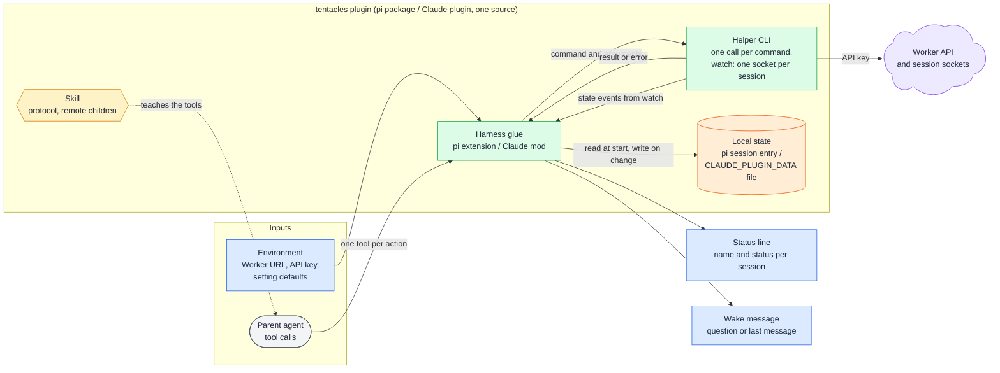
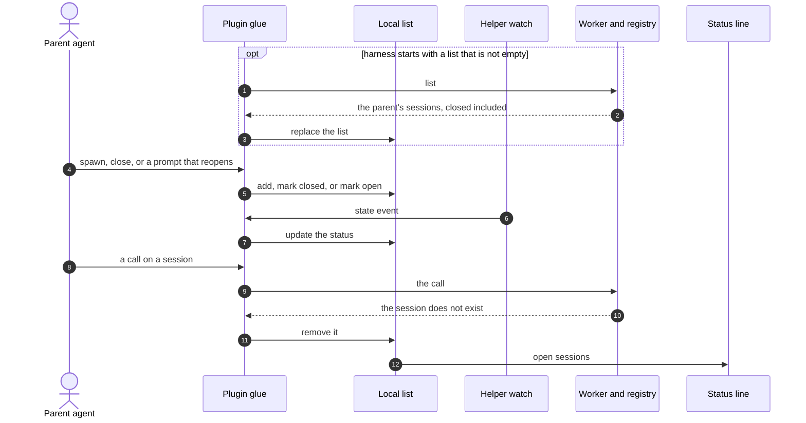

# Plugin

## 🔭 Overview

The tentacles plugin gives a parent agent on pi or Claude Code one tool per action on its remote sessions: spawn, prompt, messages, wait (pi only), list, close and answer. It is built from one source into a pi package and a Claude plugin. Each tool call runs a bundled helper CLI that calls the [Worker API](worker-api.md), and a long-running watch holds one socket per session to update the status line and wake the parent when a session asks, finishes or fails. The plugin keeps a local list of the parent's remote sessions per harness session and syncs it with the Worker when the harness starts. It reaches tentacles only through the Worker API and the session sockets.

## 🏗️ Architecture

The **harness glue** is a pi extension on pi and a Claude mod on Claude Code. It registers the tools, turns each tool call into a helper command, keeps the parent's local state, updates the status line and delivers the wakes.

The **helper CLI** runs as one process per command, and as a long-running watch that holds one socket per session in the local state and hands each state change back to the glue. It reads the Worker URL and the API key from environment variables, and the default session settings come from environment variables too.

The **local state** is the parent's list of remote sessions, per harness session: a custom session entry on pi, a file under `CLAUDE_PLUGIN_DATA` on Claude Code. The glue reads it when the harness starts and writes it whenever the parent's sessions change.

The **skill** teaches the parent agent the tools with the same protocol it follows for local subagents, and adds that its children are remote: nothing of theirs runs locally, and their state and output are reachable only through the tools.

## ♠️ What it exposes

| Tool | On Claude Code (model sees) | On pi | Worker call |
|---|---|---|---|
| spawn | `mcp__tentacles__spawn` | `tentacles_spawn` | create |
| prompt | `mcp__tentacles__prompt` | `tentacles_prompt` | prompt |
| messages | `mcp__tentacles__messages` | `tentacles_messages` | messages |
| wait | none | `tentacles_wait` | waits on the session socket |
| list | `mcp__tentacles__list` | `tentacles_list` | list |
| close | `mcp__tentacles__close` | `tentacles_close` | close |
| answer | `mcp__tentacles__answer` | `tentacles_answer` | answer |

Each tool takes the arguments of its Worker API call and returns its result. A Worker error, such as a deleted or unknown session or an answer to a question that is not waiting, reaches the agent as a tool failure carrying the Worker's message. On Claude Code the plugin registers the tools by their bare names and the model sees them under the plugin's MCP prefix; on pi they carry the `tentacles_` prefix themselves.

## ⏰ Wake messages

The watch wakes the parent with what it needs to act without another call:

| When | What the parent receives |
|---|---|
| a remote agent asks a question | the session, the question id and the question text |
| a run finishes | the session and its last message |
| a run fails | the session and its failure |

[question-round-trip](question-round-trip.md) follows a question to the parent and back.

> [!WARNING] A headless parent gets no wake
> A parent running headless (`claude -p`) is never woken, the same as with local subagents. It learns of a question or a finished run only by calling the tools, and a question it never reads keeps its session waiting.

## 🔄 Parent state and sync

The plugin keeps, per harness session, the parent's remote sessions with their name and status, closed ones included. The parent is identified by its harness and that harness's session id, which the Worker also stores on each session.

When the harness starts and the local list is not empty, the plugin asks the Worker for the parent's sessions and replaces the list with the answer (1 to 3). With an empty list, the plugin makes no call. A forked parent (pi's `/fork`, Claude Code's `/branch` or `--fork-session`) has a new session id, so its first sync returns nothing and its list empties: a fork sees none of the original's remote sessions.

spawn adds a session, close marks it closed, and a prompt that reopens a closed session marks it open again (4, 5). The watch holds a socket for each session in the list, and every state event updates that session's status (6, 7).

Closed sessions stay in the list and in the list tool's result, so the parent can reopen one. The status line shows only the open sessions (12); a sync that returns a closed session brings it back as closed, hidden from the status line.

A deleted session leaves the list the first time the plugin learns of it: the start-up sync omits it (1 to 3), or any call on it (prompt, messages, close or answer) returns that the session does not exist (8 to 11).

> [!NOTE] Why the list is kept both locally and in the Worker
> The local list lets a harness that has never spawned a remote session start without calling the Worker. The Worker's copy lets a harness that does have sessions recover their current status, including changes it missed while it was closed.

> [!WARNING] A deleted session lingers until the plugin learns of it
> The daily cleanup deletes a session without telling its parent. Until the next start-up sync or the next call on that session, the local list, and the status line if the session was open, still name it.

---

Related: [worker-api](worker-api.md), [question-round-trip](question-round-trip.md), [sessions](sessions.md), [runtime-components](runtime-components.md), [remote-agents](../product-design/remote-agents.md)
