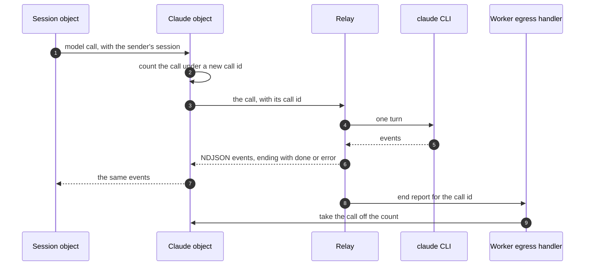
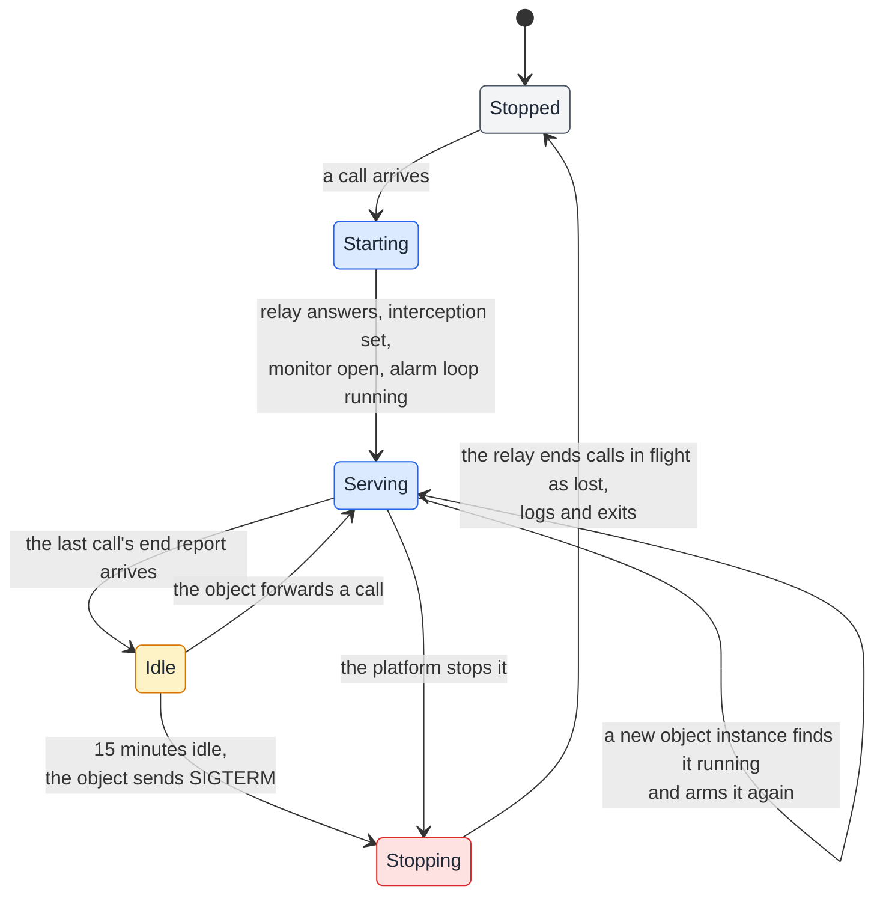
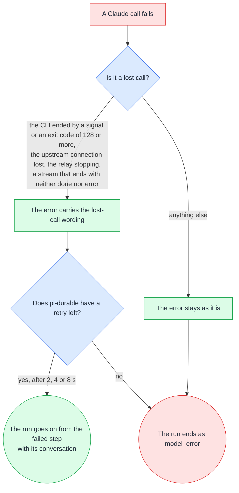

# Claude container

## 🔭 Overview

One Claude container serves every Claude model call from every session and subagent, on the owner's Claude subscription. A single Durable Object, the Claude object, owns the container. The object starts the container on the first call that finds it stopped, keeps itself and the container alive while calls are in flight and for 15 minutes after the last one, and then stops the container itself. Inside the container, the relay is the first and only long-lived process. The relay runs each call through one claude CLI process, streams the result back, and keeps every failure inside the call that caused it, so one call's failure never ends another call or the relay. A call lost on the way, because the container stopped or a connection dropped, reaches the session as an error that pi-durable retries.

## 📩 How a call travels

The session object sends each Claude call to the Claude object with the sender's session (1). The object counts the call under a new call id (2) and forwards the call to the relay with that id (3). The relay runs one turn through the claude CLI (4, 5) and streams pi-ai's events back as NDJSON, one event per line, ending with done or error (6, 7). When the call ends, however it ends, the relay sends an end report for the call id to the internal host `tentacles.internal` (8). The container's outbound interception hands the report to the Worker's egress handler, and the handler takes the call off the Claude object's count (9).

## 🟢 How the Claude container starts, stays up and stops

The Claude object starts the container when a call finds it stopped. Calls that arrive during the start wait for it, and none reaches the relay before the relay answers. Once the relay answers, the object sets the outbound interception that adds the subscription token, holds the container's monitor open and keeps an alarm pending. Each alarm pass waits about a minute before setting the next one, so the object always has work in progress while the container runs. A new instance of the object that finds the container running arms it the same way: interception, inactivity timeout, monitor and alarm.

The object counts every call it forwards and takes the call off its count when the relay reports the call's end, aborted calls included. The object keeps the count and the time of the last forward or end report in its storage, so a new instance takes up the same count and the same timer. On an alarm pass, when no call is in flight and 15 minutes have passed since the last forward or end report, the object marks itself stopping and sends the container SIGTERM. A call that arrives while the object is stopping waits until the container has stopped, and the object then starts the next container for it. When the monitor reports that the container stopped, whoever stopped it, the object clears its count and its stopping mark.

> [!NOTE] Why the Claude container stops after 15 minutes
> Fifteen minutes outlasts Anthropic's five-minute prompt cache and the time a container takes to start, so a parent that prompts a session again soon after a run finishes reaches a container that is still up and a cache that is still warm.

> [!WARNING] When the runtime replaces the Claude object, its container stops
> When a Durable Object's handler returns while its streamed response is still running, the object has no work in progress. The runtime then replaces the object, about once a minute under steady use, and the container stops with it. Every call in flight dies: the CLI exits with code 143 and the session's run fails.

> [!NOTE] Why the object counts calls itself and keeps its own timer
> The object knows of a call before the call reaches the relay, so an alarm pass never finds an empty count while a call is on its way, and when the object stops the container, no call that has already started is cut off. The count lives in storage because a new instance would otherwise start from an empty count and stop the container under a call in flight.

## 🛡️ How the relay contains failures

A failure inside a call ends that call only: the relay kills its CLI process and closes its sockets, and every other call keeps running. When the call fails before its stream started, the relay answers with the error. When it fails after, the relay sends an error event. The relay logs any uncaught exception or rejection with its stack and keeps running.

On SIGTERM, from the Claude object's idle stop or from the platform, the relay takes no new call, ends every call in flight with the lost-call error, logs the signal and exits. A call that reaches the relay while it stops gets a 503 with the same wording. The Claude object holds new calls once it decides to stop, so a call reaches a stopping relay only when the platform stopped the container.

## ⚖️ Which failures are lost calls

A lost call is a call that the model never answered because the CLI, the relay, the container or a connection between them failed. The relay recognises a CLI that ends by a signal or with an exit code of 128 or more, and recognises its own stop. The CLI already reports a dropped upstream connection with "connection lost". The provider treats a stream that ends with neither done nor error as lost, which covers a container that dies without SIGTERM. Each of these errors reads "Claude relay lost the call (connection lost): <message>", and pi-durable retries the call, since pi-durable reads the error text ([sessions](../../sessions.md)). Any other error, such as a refusal or an account limit, stays as it is and ends the run as `model_error`.

## 📜 What each side logs

The relay writes one JSON object per line on stdout, which reaches Workers observability. It never logs a prompt, a message part or an output.

| Record | Written when | Carries |
|---|---|---|
| relay start | the relay listens | the port |
| relay signal | the relay receives SIGTERM or SIGINT | the signal |
| relay exit | the relay exits after a signal | nothing more |
| call start | a call reaches the relay | the call id, the sender's session, the conversation, the model |
| call end | a call ends | the call id, the sender's session, the conversation, how it ended: done, failed, lost, aborted by the caller or stopped by the signal, with the error message for failed and lost |
| error | an error inside a call or an uncaught one | the message and the stack, and the call id and sender for a call's error |

The conversation is pi-durable's id for the conversation that made the call, so a subagent's calls carry a different conversation id from the calls of its root run. On the session side, every failed Claude call leaves one line in the Worker's log with the same session, conversation and error message, so a reader can match the relay's records and the Worker's line for one call.

## ⚙️ Implementation details

The relay and the provider that calls it both import the `relay-protocol` package, which defines the request body, the call id and the header that carries it, the path of the end report, and the lost-call wording. The Cloudflare provider owns the end report's route through `tentacles.internal` and the egress handler.

---

Related: [deploy](deploy.md), [sessions](../../sessions.md), [runtime-components](../../runtime-components.md)
