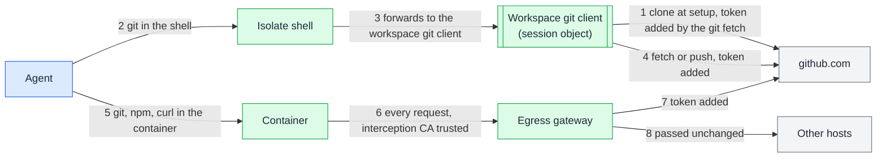

# Cloudflare workspace

## 🔭 Overview

On Cloudflare, a session's workspace is a Cloudflare Computer workspace that lives in the session's Durable Object. Its files sit in the object's SQLite and are mounted into the container at `/workspace`, at the same paths on both sides. The agent gets Computer's tools: file tools that work on the object's files directly, and `exec`, which runs a command on the isolate shell or the container. One git client per workspace, with a fetch that adds the GitHub token, serves clone, fetch and push from the object, the shell and codemode; git run inside the container reaches GitHub through the egress gateway, which adds the token there. Computer and the platform run the container's lifecycle: it starts on the first command sent to it and stops when idle.

## 🖥️ The backends and what each can run

[Workspace](../../workspace.md) draws how a tool call reaches the files and the backends.

The workspace registers two backends, and `exec`'s `backend` parameter names one of them on each call:

| Backend | What it is | What it can run | Output |
|---|---|---|---|
| shell | just-bash in a Dynamic Worker, on the Durable Object's files | text tools such as grep, sed, sort and tar, and `git`, which forwards to the workspace git client; no node, npm or other binaries | the whole output when the command ends |
| container | a Cloudflare container running computerd, with the Durable Object's files mounted at `/workspace` | anything the image holds or the agent installs: node, npm, mise, real git, servers for a preview | each line as it is printed, from Computer's exec event stream |

The file tools, `read`, `ls`, `find`, `grep`, `write`, `edit` and `delete`, take no backend and work on the Durable Object's files. The provider sets `read`, `ls`, `find` and `grep` to replay safe and `write`, `edit`, `delete` and `exec` to unsafe.

The provider writes each backend's description, which Computer puts in front of its own text, so the agent picks a backend from what the real setup can do. Where Computer's built-in text does not match the setup, such as the shell's "no direct network", the provider's description corrects it. The provider leaves long commands on the shell, and their output comes back when they end.

`exec` hands the harness each stdout and stderr event in the order it arrives, then the result with the command, the exit code and the full output. Computer reports a non-zero exit as a success, so the provider sets the error flag itself when the exit code is not 0.

> [!NOTE] Why the shell's output arrives only at the end
> Computer's shell backend awaits just-bash's `exec` to completion and builds its event stream from the finished result, and just-bash has no output callback. A container command streams; a shell command cannot.

## 📂 `/workspace` in the Durable Object

The workspace's files live in the session Durable Object's SQLite, next to pi-durable's tables. computerd mounts them in the container at `/workspace` through FUSE, so `/workspace/repo`, `/workspace/skills` and `/workspace/context` have the same paths for the file tools, the shell and the container. Only `/workspace` is shared: anything the container writes elsewhere sits on the container's own disk and is lost when the container stops. The runtimes mise installs live outside `/workspace`, so the agent installs them again after a stop.

`node_modules` and every other tree an install writes under `/workspace` sync into the Durable Object like any other file, and the agent's instructions do not mention it.

> [!NOTE] Why `node_modules` stays in the synced workspace
> Keeping it on the container's disk would hide it from the file tools and the shell, and a stop would lose it. Syncing costs install time instead: an npm install took 11.4 s synced against 4.8 s on the container's disk.

At spawn, the provider builds the workspace and runs the setup without starting a container: it clones the repository into `/workspace/repo` through the git client and writes the skills and context archives' files into `/workspace/skills` and `/workspace/context` through the workspace's file system. Deleting the session clears the Durable Object's storage, and the workspace's files with it.

## 🔀 Git and egress

The workspace git client clones at setup (1). Git run in the isolate shell (2) forwards to the same client (3), whose fetch adds the GitHub token (4); codemode scripts' git goes through the same client. Anything the agent runs in the container (5) goes through the egress gateway (6), which adds the token on github.com (7) and passes other hosts unchanged (8).

The egress gateway is Computer's `http-gateway` mode, fixed by the provider: every outbound request from the container is intercepted and handed to the gateway, which lets all traffic through and adds the token only on github.com. The token never enters the container, its git config or its remote URLs.

The container trusts the gateway's interception certificate before the agent's first command runs. Cloudflare writes that certificate into the container only after the container starts, and computerd passes exec'd commands nothing but `HOME`, `PATH` and the working directory, so the image installs the certificate into the system trust store once it appears. curl, git, npm and node's fetch then accept the intercepted connections.

The identity from create is set on the git client as its default identity and in the environment of every container command, as `GIT_AUTHOR_*` and `GIT_COMMITTER_*`. The two routes read different sources, so the provider sets both.

> [!TIP] Rejected: cloning and pushing with git in the container
> Container git needs the container started and the interception certificate trusted, and pays a cold start before the first command. The git client in the Durable Object clones in under a second with no container, keeps the token outside every backend, and leaves container git to what the agent runs there.

## 📦 The image

The container runs the workspace image with Computer's daemon added: computerd and FUSE, on top of what the agent needs to install its own toolchain in any language: git, CA certificates, `curl`, `xz`, `unzip`, `bzip2`, `ps` and the `libatomic` library that prebuilt Node binaries load. It also holds mise, a runtime manager that installs Node, Python, Go and other runtimes on demand, as in `mise use node@24`, with mise's shims directory on `PATH`. The image has no preinstalled language runtime, no Chrome and no Docker; the agent installs anything else it needs. The image's name is the `default` value of the session's image setting, and the size setting picks the container's instance type.

> [!WARNING] Agent commands can read computerd's secret
> computerd's environment, including its `RPC_CLIENT_SECRET`, is readable from `/proc/1/environ` by any command the agent runs. The secret only lets a caller drive the same container the agent already controls, so the provider accepts it.

## 🟢 The container's lifecycle

Computer and the platform run the container; the provider has no start, stop or keepalive call. The first command sent to the container starts it, Computer restarts it if computerd does not come up, and Cloudflare Containers stops it once the Durable Object has been idle. A stop keeps `/workspace` and loses the running processes, including servers started for a preview, and anything outside `/workspace`. A cold start with the image cached takes about 1 to 3 seconds before the first command runs.

---

Related: [workspace](../../workspace.md), [deploy](deploy.md), [preview-and-browser](preview-and-browser.md), [runtime-components](../../runtime-components.md)
