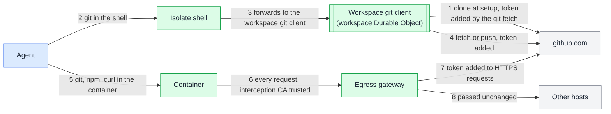

# Cloudflare workspace

## 🔭 Overview

On Cloudflare, a session's workspace is a Cloudflare Computer workspace that lives in the session's own workspace Durable Object, in the Workspace Worker. The session object reaches that object by the session id. Its files sit in that object's SQLite and are mounted into the container at `/workspace`, at the same paths on both sides. The agent gets Computer's tools: file tools that work on the object's files directly, and `exec`, which runs a command on the isolate shell or the container. The session object builds the tools over Computer's client for that object. One git client per workspace, with a fetch that adds the GitHub token, serves clone, fetch and push from the object, the shell and codemode; git run inside the container reaches GitHub through the egress gateway, which adds the token there. Computer and the platform run the container's lifecycle: it starts on the first command sent to it and stops when idle.

## 🖥️ The backends and what each can run

[Workspace](../../workspace.md) draws how a tool call reaches the files and the backends.

The workspace registers two backends, and `exec`'s `backend` parameter names one of them on each call:

| Backend | What it is | What it can run | Output |
|---|---|---|---|
| shell | just-bash in a Dynamic Worker, on the Durable Object's files | text tools such as grep, sed, sort and tar, and `git`, which forwards to the workspace git client; no node, npm or other binaries | the whole output when the command ends |
| container | a Cloudflare container running computerd, with the Durable Object's files mounted at `/workspace` | anything the image holds or the agent installs: node, npm, mise, real git, servers for a preview | each line as it is printed, from Computer's exec event stream |

The file tools, `read`, `ls`, `find`, `grep`, `write`, `edit` and `delete`, take no backend and work on the Durable Object's files. The provider sets `read`, `ls`, `find` and `grep` to replay safe and `write`, `edit`, `delete` and `exec` to unsafe.

The session object builds the tools whenever it starts: it awaits Computer's workspace client for the session's workspace Durable Object once and keeps it. The file tools are Computer's own pi tools over that client, each wrapped as a pi-durable registration: its `execute` passes the call's id and abort signal to Computer's tool and returns the tool's content as the output, with its error flag; the wrapper drops the details Computer adds. `exec` keeps Computer's declaration but uses the provider's own `execute`, which reads the client's exec events, so the output arrives as the command prints it. Computer's own `exec` returns only when the command ends. Stopping a call kills its command.

The provider writes each backend's description, which Computer puts in front of its own text, so the agent picks a backend from what the real setup can do. Where Computer's built-in text does not match the setup, such as the shell's "no direct network", the provider's description corrects it. The provider leaves long commands on the shell, and their output comes back when they end.

`exec` hands the harness each stdout and stderr event in the order it arrives, then the result, whose output is a JSON text with the command, the backend, the exit code and the full stdout and stderr. Computer reports a non-zero exit as a success, so the provider sets the error flag itself when the exit code is not 0.

> [!NOTE] Why the shell's output arrives only at the end
> Computer's shell backend awaits just-bash's `exec` to completion and builds its event stream from the finished result, and just-bash has no output callback. A container command streams; a shell command cannot.

## 📂 `/workspace` in the Durable Object

The workspace's files live in the SQLite of the session's workspace Durable Object. computerd mounts them in the container at `/workspace` through FUSE, so `/workspace/repo`, `/workspace/skills` and `/workspace/context` have the same paths for the file tools, the shell and the container. Only `/workspace` is shared: anything the container writes elsewhere sits on the container's own disk and is lost when the container stops. The runtimes mise installs live outside `/workspace`, so the agent installs them again after a stop.

`node_modules` and every other tree an install writes under `/workspace` sync into the Durable Object like any other file, and the agent's instructions do not mention it.

> [!NOTE] Why `node_modules` stays in the synced workspace
> Keeping it on the container's disk would hide it from the file tools and the shell, and a stop would lose it. Syncing costs install time instead: an npm install took 11.4 s synced against 4.8 s on the container's disk.

At spawn, the session object calls the workspace Durable Object's `setUpWorkspace` with the setup's init values. The setup runs without starting a container. It checks the image and size. It then clones the repository into `/workspace/repo` through the git client and, at the same time, writes the skills and context files into `/workspace/skills` and `/workspace/context` through the workspace's file system. Once both end, it stores the image and size. With no repository it creates `/workspace/repo` empty, and it creates the skills and context folders when no files fill them. When a step fails, the object clears its storage and answers with the failure: its error name and message, as plain data. The session object decodes that answer into the typed error. A rejected call or an answer it cannot decode becomes `WorkspaceUnavailable`.

When the session is deleted, the workspace Durable Object stops its container, deletes its alarm, clears its storage and waits until the cleared storage is written.

The session object keeps one stub for the workspace object and uses it for the client, the setup and the preview requests. The setup and the deletion run one at a time through a promise chain inside the object, so a deletion that arrives during a setup waits for it.

> [!NOTE] Why the setup answers its failure instead of throwing it
> A call that throws reaches the session object as an untyped error, so the type of the failure would have to travel in the error's text. The setup answers with the failure as data instead, validated with the schema of the two setup errors on both sides.

> [!NOTE] Why the workspace object does not reset itself
> The `Workspace` in memory still believes its tables exist once the storage is cleared. Nothing calls it afterwards: a session id is never reused, a session whose setup failed is never set up again, and the only later call is the deletion, which clears storage and container without using Computer's tables.

> [!TIP] Rejected: blocking concurrency around the setup and the deletion
> `blockConcurrencyWhile` would also keep the two apart, but the clone streams a request body that never completes inside its callback, so the setup hangs. The promise chain gives the same order without it.

## 🔀 Git and egress

The workspace git client clones at setup (1). Git run in the isolate shell (2) forwards to the same client (3), whose fetch adds the GitHub token (4); codemode scripts' git goes through the same client. Anything the agent runs in the container (5) goes through the egress gateway (6), which adds the token on github.com (7) and passes other hosts unchanged (8).

The egress gateway is Computer's `http-gateway` mode, fixed by the provider: Computer intercepts every outbound request from the container and hands it to the gateway. The gateway is the Workspace Worker's default handler. It lets all traffic through, adds the token only to HTTPS requests to github.com, and answers `/cdp/` requests with the CDP relay ([preview-and-browser](preview-and-browser.md)). The git client's fetch applies the same rule, so a plain-HTTP request to github.com carries no token. The workspace object reaches the gateway through a loopback to the Worker's own default handler with props that mark the request as the container's; a request without them gets a 404. The token never enters the container, its git config or its remote URLs.

The container trusts the gateway's interception certificate before the agent's first command runs. Cloudflare writes that certificate into the container only after the container starts, so the image's entrypoint waits for the file, up to 20 seconds, before it starts computerd. It then copies the certificate into the system trust store, which curl and git read, and writes npm's `cafile` into `/root/.npmrc`, which npm reads under the `HOME` that computerd passes on. When the certificate never appears, computerd starts once the wait ends.

> [!NOTE] Why the entrypoint waits in the foreground
> A wait in the background would let the first command after a cold start run before the certificate is trusted, and its first HTTPS request would fail.

Node reads neither the system trust store nor `.npmrc`, and computerd passes exec'd commands nothing but `HOME`, `PATH` and the working directory. The provider therefore sets `NODE_EXTRA_CA_CERTS` in the environment of every container command, pointing at the certificate's copy in the system certificate directory, and node's fetch accepts the intercepted connections.

The Workspace Worker reads the identity from its deploy variables. The provider sets it on the git client as its default identity and in the environment of every container command, as `GIT_AUTHOR_*` and `GIT_COMMITTER_*`. The two routes read different sources, so the provider sets both.

The identity and `NODE_EXTRA_CA_CERTS` reach a command through the container backend, which is Computer's, wrapped so that each command's environment gets both after the caller's own variables, which cannot override them.

> [!TIP] Rejected: cloning and pushing with git in the container
> Container git needs the container started and the interception certificate trusted, and pays a cold start before the first command. The git client in the Durable Object clones in under a second with no container, keeps the token outside every backend, and leaves container git to what the agent runs there.

## 📦 The image

The container runs the workspace image, built on Debian trixie-slim, with Computer's daemon added: computerd and FUSE (`fuse3` and `libfuse2t64`), on top of what the agent needs to install its own toolchain in any language: git, CA certificates, `curl`, `xz`, `unzip`, `bzip2`, `ps` and the `libatomic` library that prebuilt Node binaries load. `package.json` pins the version of the Computer package that the Worker bundles. The deploy builds the image with the computerd release of that same version, so the version is stated in one place. The entrypoint trusts the interception certificate and then runs computerd as the container's main process. The image also holds mise, a runtime manager that installs Node, Python, Go and other runtimes on demand, as in `mise use node@24`, with mise's shims directory on `PATH`. The image has no preinstalled language runtime, no Chrome and no Docker; the agent installs anything else it needs. The image's name is the `default` value of the session's image setting, and the size setting picks the container's instance type, as the container's lifecycle describes.

> [!WARNING] Agent commands can read computerd's secret
> computerd's environment, including its `RPC_CLIENT_SECRET`, is readable from `/proc/1/environ` by any command the agent runs. The secret only lets a caller drive the same container the agent already controls, so the provider accepts it.

## 🟢 The container's lifecycle

Computer and the platform run the container; the provider has no start, stop or keepalive call. The first command sent to the container starts it, Computer restarts it if computerd does not come up, and Cloudflare Containers stops it once the workspace Durable Object has been idle. Each start and restart asks for the instance type the session's size setting names. The setup stores the size, and a wrapper around Computer's container host adds it to every start and restart. A workspace with no stored size starts at `basic`.

> [!NOTE] Why a wrapper adds the size to each start
> Computer's container backend fixes its instance type when it is built, before any setup has stored the size the session asked for, and takes no function to read it later. The wrapper reads the stored size at each start and restart, so the first container and one after a restart get the requested size. A stop keeps `/workspace` and loses the running processes, including servers started for a preview, and anything outside `/workspace`. A cold start with the image cached takes about 1 to 3 seconds before the first command runs.

## 🧩 The Computer adapters

The code that adapts Computer 0.11.4 to this setup sits in one folder of the provider package, `packages/provider-cloudflare/src/computer/`, so an upgrade of the Computer package is reviewed in one place. The folder's README lists each adapter with the Computer API it intercepts and why. There are three: the container backend wrapper that adds the git identity and `NODE_EXTRA_CA_CERTS` to every container command, the wrapper around the container host that adds the stored size to every start and restart, and the tools, which wrap Computer's file tools and replace its `exec`. Each is described in the section of this note that covers what it changes. The Workspace Worker, the workspace object, the gateway and the session object use the adapters and stay outside the folder.

---

Related: [workspace](../../workspace.md), [deploy](deploy.md), [preview-and-browser](preview-and-browser.md), [runtime-components](../../runtime-components.md)
