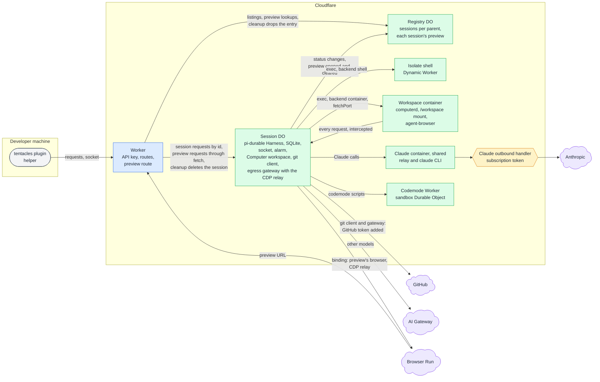

# Cloudflare deploy

## 🔭 Overview

On Cloudflare, tentacles runs as one Worker that is the only entry point, one registry Durable Object for everything that spans sessions, one session Durable Object per session running pi-durable and holding the session's Computer workspace, a Codemode Worker for codemode scripts, and one Claude container shared by every session. Models other than Claude go through AI Gateway, and the preview's browser is a Browser Run browser opened through a binding. No container holds a credential: the workspace's git client and egress gateway add the GitHub token, and the Claude container's outbound handler adds the subscription token. One Alchemy stack declares every resource.

## 🏗️ Architecture

### 🚪 Worker

The Worker is the only way in. It checks the API key on every plugin request and socket, then routes it: listings and preview lookups go to the registry, and everything about one session goes to that session's Durable Object by its id. Its preview route turns a preview URL's token into a session and a port and hands the request to the session's Durable Object through the object's `fetch` ([preview-and-browser](preview-and-browser.md)). The API answers at `tentacles.asermax.com`, and previews at `<token>-tentacles-preview.asermax.com`. The Worker keeps no state of its own; the preview tokens live in the registry. A cron trigger on the Worker fires the daily cleanup job. [worker-api](../../worker-api.md) lists its calls and the session socket.

### 📒 Registry Durable Object

The registry is one Durable Object for the whole deploy, holding the entries [sessions](../../sessions.md) describes in SQLite. When the preview tool opens a preview, the registry generates the token, records it and the port on the session's entry, replacing any preview already open, and returns the token. When a run stops, the session tells the registry, which clears the session's preview.

### 🧠 Session Durable Object

Each session is one Durable Object keyed by its session id, and it fills five roles: `SessionHost`, `SessionStorage` (its SQLite), `WakeTimer` (its alarm), `ParentChannel` (its WebSockets) and `Workspace`. It runs pi-durable's Harness over its SQLite, with the question tool and the `onWake` alarm that resumes a run after an eviction. At spawn it builds the session's Computer workspace in the same SQLite storage and runs its setup; from then on the workspace's files, its git client and its container live in the object ([computer-workspace](computer-workspace.md)). The egress gateway that handles the container's outbound requests, including the CDP relay, also runs in the object. It sends each model call where the session's settings say: Claude models to the shared Claude container, other providers to AI Gateway through `env.AI`. It opens and closes the preview's Browser Run browser through its own binding. The daily cleanup job deletes a session through its Durable Object, which clears the object's storage, the workspace's files included, then removes the session's registry entry itself.

### 🤖 Shared Claude container

One container runs pi-claude-code's relay and the claude CLI for every session, on the owner's Claude subscription. No session owns it: a model call from any session keeps it up, and it stops 15 minutes after the last call from any session.

> [!NOTE] Why the Claude container stops after 15 minutes
> Fifteen minutes outlasts Anthropic's five-minute prompt cache and the time a container takes to start, so a parent that prompts a session again soon after a run finishes reaches a container that is still up and a cache that is still warm.

### 🧪 Codemode sandbox

The scripts the agent writes with its codemode tool run in pi-durable's QuickJS sandbox, in a sandbox Durable Object of a separate Worker, which the Worker binds by name. Each session's scripts reach it from the session object, through the `CodeSandbox` contract, and call the workspace's tools by name.

### 🔐 Credentials and outbound handlers

No container holds a credential. The Claude container's outbound handler adds the Claude subscription token to every request to Anthropic. The workspace adds the GitHub token in two places outside the container: its git client's fetch, for clone, fetch and push from the session object and the isolate shell, and its egress gateway, for every request the container sends to github.com ([computer-workspace](computer-workspace.md)). Both tokens are Worker secrets, as is the API key and the secret that signs CDP tokens. The author name and email every session commits with are deploy variables; they are not credentials, and [workspace](../../workspace.md) covers how they reach every git route.

> [!WARNING] Containers run where Cloudflare places them
> Containers are meant to run in North America (regions ENAM and WNAM), and nothing enforces it: Cloudflare offers no region setting for containers a Durable Object owns. A session started far from North America can get a container placed elsewhere, and nothing reports it.

## 🔌 Which part fills each contract

| Contract | On Cloudflare |
|---|---|
| `SessionHost` | the session Durable Object, reached by its id |
| `SessionStorage` | the session Durable Object's SQLite |
| `WakeTimer` | the session Durable Object's alarm |
| `ParentChannel` | the session Durable Object's WebSockets |
| `RegistryStore` | the registry Durable Object |
| `Workspace` | a Computer workspace in the session Durable Object, with the isolate shell and container backends ([computer-workspace](computer-workspace.md)) |
| `Browser` | Browser Run through the session object's binding; agent-browser reaches it through the CDP relay in the egress gateway ([preview-and-browser](preview-and-browser.md)) |
| `PreviewRouter` | the token subdomain `https://<token>-tentacles-preview.asermax.com`, served by the Worker's preview route and the registry |
| `ModelProviders` | the shared Claude container for Claude, AI Gateway through `env.AI` for the rest |
| `Scheduler` | a cron trigger on the Worker |
| `CodeSandbox` | a Durable Object in the Codemode Worker |

## 📦 The deploy stack

The provider is the `provider-cloudflare` package. It exports an Alchemy stack, which a deploy runs on the stage `prod`. The stack declares the Worker with its routes and cron trigger, the two Durable Object classes, the workspace container's image and the Claude container, the Codemode Worker, the Browser Run and AI bindings, and the secrets and deploy variables. The code that runs in those resources builds the Layer of the contracts from the same declarations ([runtime-components](../../runtime-components.md)).

---

Related: [runtime-components](../../runtime-components.md), [computer-workspace](computer-workspace.md), [preview-and-browser](preview-and-browser.md), [sessions](../../sessions.md), [worker-api](../../worker-api.md)
