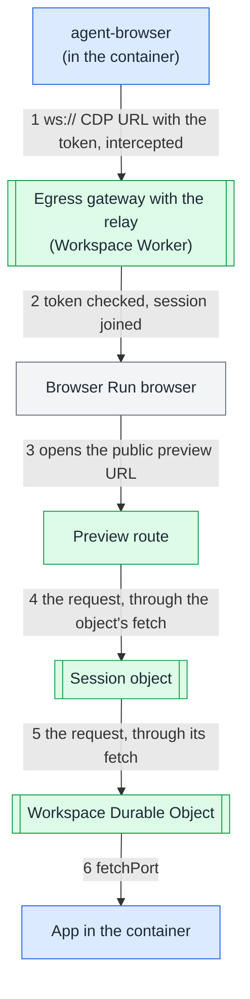

# Cloudflare preview

## 🔭 Overview

On Cloudflare, a preview URL is a public token subdomain, `https://<token>-tentacles-preview.asermax.com`. The Worker's preview route hands each request to the session's Durable Object through the object's `fetch`. The session object hands the request to its workspace Durable Object the same way. The workspace object forwards it to the app's port in the container with Computer's `fetchPort`, so plain requests and WebSockets both reach the app. The preview's browser is a Browser Run browser that the session object opens through its binding. agent-browser in the container connects to it with a `ws://` CDP URL, which the egress gateway answers itself by running the CDP relay.

## 📩 Flow

agent-browser connects to the `ws://` CDP URL the preview tool returned (1). Cloudflare intercepts the connection inside the container and hands it to the egress gateway, which runs the relay itself: it checks the token, opens the Browser Run session through the binding and joins the two WebSockets (2). The browser opens the public preview URL (3). The preview route looks up the token in the registry and hands the request to the session's Durable Object through the object's `fetch` (4). The session object marks it with an `x-tentacles-preview-port` header naming the port and hands it to its workspace Durable Object through that object's `fetch` (5). The workspace object reads the port from the header and forwards the request to the app through `fetchPort` (6).

## 🌐 The preview route and `fetchPort`

The preview route turns the token in the subdomain into a session and a port, then calls the session Durable Object's `fetch` with the request. The object matches the preview path and passes the request to the workspace's `forward`, which sets the `x-tentacles-preview-port` header and hands the request to the workspace Durable Object through the workspace object's `fetch`. The workspace object removes the header, rebuilds the request as `http://localhost` with the request's path and query, and calls `fetchPort` on the container; a request without the header goes to Computer's own handler. The app's answer comes back the same way. When `fetchPort` throws, usually because nothing listens on the port, the workspace object answers 502, and `forward` answers 502 when it cannot reach the workspace object; a request sent right after the agent starts its server can get one 502 before the server listens.

> [!NOTE] Why the route uses the object's `fetch` and not a method call
> A method call's return value is serialized, and a Response that carries a WebSocket cannot be: the upgrade fails with `DataCloneError`. Handing the request to each object's `fetch`, at both hops, returns the Response as it is, so the app's WebSockets, such as a dev server's hot reload, work, and plain requests work the same.

> [!TIP] Considered and not chosen: a preview with no public route
> The relay can answer the browser's requests for a private host over CDP with `Fetch.fulfillRequest`, and Browser Run can send a private host's requests to a Worker with `outboundByHost`. Both reach the app through `fetchPort` with no public URL, and neither carries WebSockets, so dev servers that need hot reload would break. The public token subdomain carries only the token, which is random and stops working when the preview closes.

## 🔗 The CDP URL and the relay in the egress gateway

The preview tool returns a CDP URL of the form `ws://<host>/cdp/<token>`, where the token is the Browser Run session id with an HMAC under a Worker secret. agent-browser connects to it from the container. Computer's interception catches the plain-HTTP WebSocket and hands it to the egress gateway, the Workspace Worker's default handler, with its upgrade. The gateway recognises `/cdp/` requests and serves them in place, with the Workspace Worker's copy of the signing secret and its Browser Run binding: it checks the token's signature, calls `connectSession` on the Browser Run binding, and joins the container's WebSocket to the browser's. The connection never leaves Cloudflare and makes no second hop. The Worker has no public CDP route.

> [!NOTE] Why the CDP URL uses `ws://`
> agent-browser verifies a `wss://` connection against roots bundled into its binary, ignores the system trust store, and refuses a CA file together with a CDP URL, so the interception certificate fails every `wss://` connection with `UnknownIssuer`. A `ws://` URL meets no certificate inside the container, and the connection from the container to the gateway stays inside Cloudflare.

## 🔒 Closing the browser

The session object closes the Browser Run session when the preview closes, when a new preview replaces it, and when the run stops. `agent-browser close` closes agent-browser's own connection and leaves the Browser Run session open with its pages, so the session object closes it through the binding.

> [!TIP] Rejected: a browser inside the workspace container
> Running Chrome in each workspace would put a browser in the image every session starts from. Browser Run gives every session the same managed browser, opened by the session object through its binding with no API token, and the image stays small.

---

Related: [workspace](../../workspace.md), [computer-workspace](computer-workspace.md), [deploy](deploy.md), [sessions](../../sessions.md)
