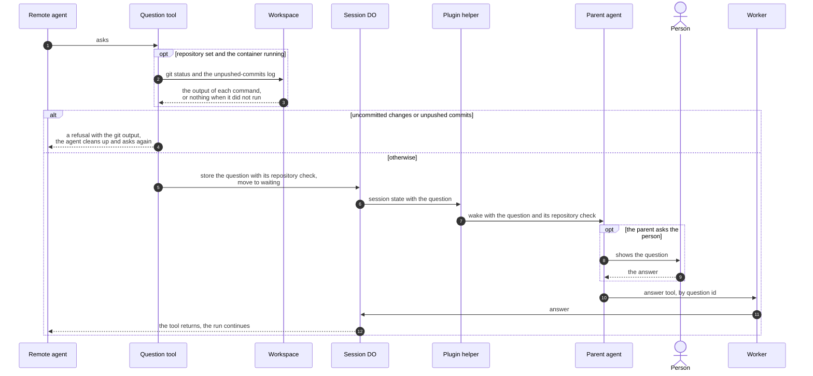
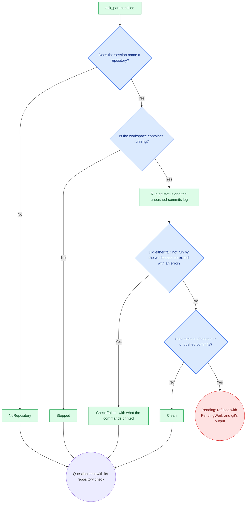

# Question round trip

## 🔭 Overview

A remote agent asks its parent through its question tool, `ask_parent`, which waits inside the run. The session stores the question and moves to waiting, the session socket carries it to the plugin's helper, and the helper wakes the parent with the question itself. The parent answers, by itself or after asking the person behind it, and the answer resolves the waiting tool call so the run continues. Only the root conversation's model can ask, never a codemode script. Every question carries the outcome of the repository check, `NoRepository`, `Stopped`, `Clean` or `CheckFailed`, which tells the parent whether the remote agent's work is known to be persisted. The tool refuses to ask while the session's repository holds work that is not committed and pushed.

## 📩 Flow

1. The agent calls the question tool.

> [!NOTE] Only the root conversation asks
> Subagent conversations inside the session do not get the question tool. A child conversation starts with a copy of its owner's extensions, and the question tool belongs to an extension only the root has. The subagent tool leaves that extension out of every copy. The parent reads only the root conversation, so a question from work it never sees would arrive without context.

2. and 3. When the session's settings name a repository and the workspace container is running, the tool runs git status and the log of unpushed commits in the workspace. When the settings name no repository, or the container is not running, the tool runs nothing there and goes on.
4. The tool refuses when both commands ran and found uncommitted changes or unpushed commits. The refusal holds the output of git status and the list of unpushed commits. The refusal is a result the agent reads, not a tool failure. The agent commits, drops the temporary work or moves it out of the repository, and calls the tool again with the same arguments.
5. Otherwise the session stores the question, its id, its text and its repository check, and moves to waiting.
6. The socket sends the session state with the question to the plugin's helper.
7. The helper wakes the parent with the question itself: the session, the question id, the text and the repository check, so the parent can answer without another call.
8. and 9. The parent answers it itself, or shows it to the person and answers when they reply.
10. and 11. The parent answers with the answer tool, by the question's id, through the Worker.
12. The answer resolves the waiting tool call and the run continues. The socket sends the new state.

A prompt sent while a question waits is a steer whatever mode the parent sends it with, and reaches the agent after the answer; a prompt neither answers nor cancels the question. A question keeps its id when an eviction makes the tool run again, so an answer sent for it still resolves it. Every eviction cuts the waiting tool call off, and pi-durable counts each cut-off toward its restart limit. The session lifts that limit while the question's call is live, so the question survives any number of evictions. An answer to a question that is not waiting returns an error, which the parent sees as a tool failure.

> [!NOTE] Why the agent commits and pushes before it asks
> A question can wait for hours while the person is away. The workspace container stops like any idle container once its lifetime passes, and its disk does not survive that. With the work pushed, the answer can arrive at any time and nothing is lost when the run continues on a fresh container.

> [!WARNING] No socket open when the question arrives
> When the parent's helper is not connected (the harness is closed, or the parent runs headless), nothing wakes the parent. The question keeps waiting in the session and arrives with the state on the next connection; until then the run stays waiting and the session is never deleted.

## ⚖️ The repository check a question carries

The tool runs the repository check before it stores the question, and the question carries its outcome:

- **NoRepository**: the session's settings name no repository, so tentacles manages none and checks nothing.
- **Stopped**: the workspace container is not running, or the session has no execution environment to run the commands in. The tool does not start a stopped container to check it: the workspace keeps itself up while it has pending work (see [workspace](workspace.md)), so a stopped container had none.
- **Clean**: both commands ran and found no uncommitted changes and no unpushed commits.
- **CheckFailed**: either command failed unexpectedly: the workspace did not run it, because it is stalled or unreachable, or it exited with an error. It carries what the two commands printed, which is empty when the workspace ran neither. The question goes to the parent anyway.

The tool refuses only when git reports what the check looks for, uncommitted changes or unpushed commits. That outcome is `Pending`, and no question carries it. Any other failure of the commands makes the outcome `CheckFailed`. Nothing retries the check: a failing workspace also fails the commands the agent runs, and the agent decides what to try again.

The parent sees the repository check, with the output that `CheckFailed` carries, wherever it sees the question: in the wake and in the session state. The session socket and the Worker API's status call both return that state (see [worker-api](worker-api.md) and [plugin](plugin.md)). A plugin that does not read the field shows the question without it.

> [!NOTE] Why a failing check still lets the question through
> A stalled or unreachable workspace cannot commit or push either, so refusing the question would leave the agent with no way to reach its parent. With `CheckFailed`, the parent knows the work may exist only on the container's disk, and reads in the commands' output why the check failed.

---

Related: [sessions](sessions.md), [worker-api](worker-api.md), [workspace](workspace.md), [plugin](plugin.md), [remote-agents](../product-design/remote-agents.md)
