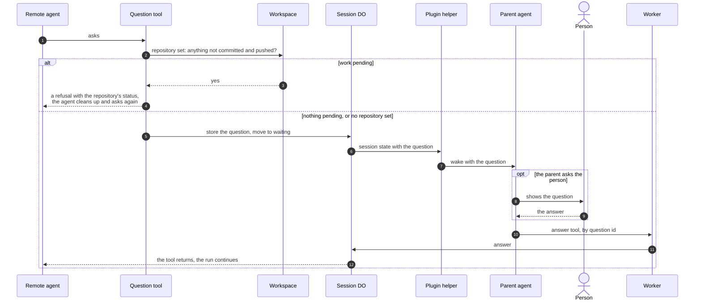

# Question round trip

## 🔭 Overview

A remote agent asks its parent through its question tool, `ask_parent`, which waits inside the run. The session stores the question and moves to waiting, the session socket carries it to the plugin's helper, and the helper wakes the parent with the question itself. The parent answers, by itself or after asking the person behind it, and the answer resolves the waiting tool call so the run continues. Only the root conversation can ask, and the tool refuses to ask while the session's repository holds work that is not committed and pushed.

## 📩 Flow

1. The agent calls the question tool.

> [!NOTE] Only the root conversation asks
> Subagent conversations inside the session do not get the question tool. pi-durable ships no subagent tool of its own, so tentacles writes one; a child conversation starts with a copy of its owner's extensions, and tentacles' subagent tool removes the question tool from that copy. The parent reads only the root conversation, so a question from work it never sees would arrive without context.

2. When the session's settings name a repository, the tool first checks it for changes that are not committed and pushed. Without a repository setting, there is nothing to check and the tool goes on.
3. and 4. While anything there is not committed and pushed, the tool returns a refusal with the repository's status. The refusal is a result the agent reads, not a tool failure. The agent commits, drops the temporary work or moves it out of the repository, and calls the tool again with the same arguments.
5. Otherwise the session stores the question, its id and text, and moves to waiting.
6. The socket sends the session state with the question to the plugin's helper.
7. The helper wakes the parent with the question itself: the session, the question id and the text, so the parent can answer without another call.
8. and 9. The parent answers it itself, or shows it to the person and answers when they reply.
10. and 11. The parent answers with the answer tool, by the question's id, through the Worker.
12. The answer resolves the waiting tool call and the run continues. The socket sends the new state.

A prompt sent while a question waits is a steer whatever mode the parent sends it with, and reaches the agent after the answer; a prompt neither answers nor cancels the question. A question keeps its id when an eviction makes the tool run again, so an answer sent for it still resolves it. Every eviction cuts the waiting tool call off, and pi-durable counts each cut-off toward its restart limit. The session lifts that limit while the question's call is live, so the question survives any number of evictions. An answer to a question that is not waiting returns an error, which the parent sees as a tool failure.

> [!NOTE] Why the agent commits and pushes before it asks
> A question can wait for hours while the person is away. The workspace container stops like any idle container once its lifetime passes, and its disk does not survive that. With the work pushed, the answer can arrive at any time and nothing is lost when the run continues on a fresh container.

> [!WARNING] No socket open when the question arrives
> When the parent's helper is not connected (the harness is closed, or the parent runs headless), nothing wakes the parent. The question keeps waiting in the session and arrives with the state on the next connection; until then the run stays waiting and the session is never deleted.

---

Related: [sessions](sessions.md), [worker-api](worker-api.md), [workspace](workspace.md), [plugin](plugin.md), [remote-agents](../product-design/remote-agents.md)
