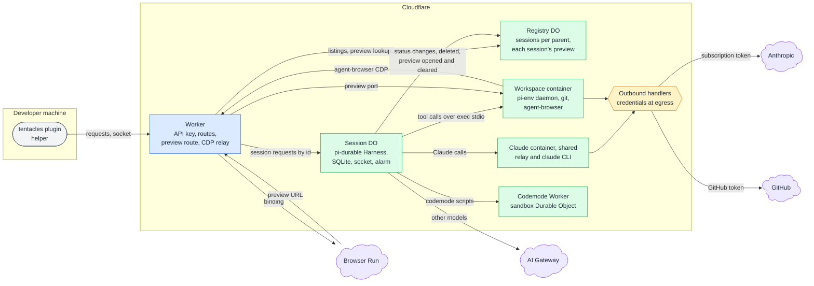
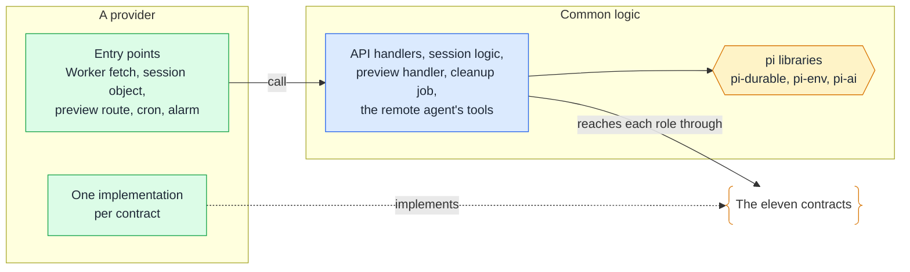

# Runtime components

## 🔭 Overview

tentacles runs on Cloudflare: one Worker as the only entry point, one registry Durable Object for everything that spans sessions, one session Durable Object per session running pi-durable, a workspace container per session for the agent's tools, and one Claude container shared by every session. Models other than Claude go through AI Gateway, and the agent's browser is a Browser Run browser reached through the Worker. No container holds a credential: outbound handlers add the Claude and GitHub tokens to requests as they leave. Each part fills a role that any provider could fill, and tentacles' shared logic reaches each role through a contract, so another setup can replace the infrastructure without changing the plugin.

## 🏗️ Architecture

### 🚪 Worker

The Worker is the only way in. It checks the API key on every plugin request and socket, then routes it: listings and preview lookups go to the registry, and everything about one session goes to that session's Durable Object by its id. It also hosts two routes of its own. The preview route turns a preview URL's token into a session and a port and forwards the request to that port in the workspace. The CDP relay connects agent-browser in the workspace to Browser Run through the binding. The relay's address carries a token that the Worker signs with its own secret, so nobody else can make a valid address. The API answers at `tentacles.asermax.com`, and previews at `<token>-tentacles-preview.asermax.com`. The Worker keeps no state of its own; the preview tokens live in the registry. [worker-api](worker-api.md) lists its calls and the session socket.

### 📒 Registry Durable Object

The registry is the one store that spans sessions: an entry per session with its name, its parent, its status and the time its last run stopped, plus the session's preview, when one is open: its port and its token. When the preview tool asks for a preview URL, the Worker generates the token and records it and the port on the session's entry, replacing any preview already open. When a run stops, the session tells the registry, which clears the session's preview. [sessions](sessions.md) lists the fields of each entry.

### 🧠 Session Durable Object

Each session is one Durable Object keyed by its session id. It runs pi-durable's Harness over its own SQLite, with the question tool and the `onWake` alarm that resumes a run after an eviction. It holds the parent's socket, which carries the session state on connect and on every change, and it owns its workspace container, which it starts on demand. It sends each model call where the session's settings say: Claude models to the shared Claude container, other providers to AI Gateway through `env.AI`. The session object never writes the status ahead of the run. It watches pi-durable's state (the run, a waiting question, the last run's failure), tells the registry each time the derived status changes, and tells the registry when the session is deleted.

### 📦 Workspace container

Each session has its own workspace container running pi-env's daemon and git, plus agent-browser when the image has it or the agent installs it. The session's tools reach the daemon over the container's exec stdio. [workspace](workspace.md) covers the container's start, lifetime and image.

### 🤖 Shared Claude container

One container runs pi-claude-code's relay and the claude CLI for every session, on the owner's Claude subscription. No session owns it: a model call from any session keeps it up, and it stops 15 minutes after the last call from any session.

> [!NOTE] Why the Claude container stops after 15 minutes
> Fifteen minutes outlasts Anthropic's five-minute prompt cache and the time a container takes to start, so a parent that prompts a session again soon after a run finishes reaches a container that is still up and a cache that is still warm.

### 🧪 Codemode sandbox

The scripts the agent writes with its codemode tool run in a sandbox Durable Object of a separate Worker, which the Worker binds by name. Each session's scripts reach it from the session object, through the `CodeSandbox` contract.

### 🔐 Outbound handlers

Neither container holds a credential. The outbound handlers add the Claude subscription token to requests to Anthropic and the GitHub token to requests to github.com, on every request. Both tokens are Worker secrets, as is the API key.

All containers run in North America.

## 🔌 Provider-neutral roles

Each component above plays a role that any provider has to fill. Several roles already sit behind an interface the pi libraries define: pi-durable takes its storage and its wake-up timer from the host, pi-env runs tools over whatever connection it is given, and pi-ai reaches models through providers. The plugin talks only to the Worker API and the session socket, so it does not change with the provider.

| Role | On Cloudflare | Contract | What the common logic asks it | Interface it builds on |
|---|---|---|---|---|
| Session host: one live instance per session, revived on demand | session Durable Object | `SessionHost` | reach a session by id and run one of its operations: create, prompt, answer, close, messages, status, connect a socket, forward a preview request, delete | pi-durable's Harness opens over any host |
| Session storage | Durable Object SQLite | `SessionStorage` | pi-durable's storage for one session | pi-durable's storage adapter |
| Wake-up timer | the object's alarm | `WakeTimer` | set or clear the one timer that resumes a run after an eviction | pi-durable's `onWake`; the host writes the timer |
| Parent socket | Durable Object WebSocket | `ParentChannel` | send the session state to every socket the parent holds open | none |
| Registry of sessions and their preview | registry Durable Object | `RegistryStore` | add an entry, record a status, list one parent's sessions, open and resolve a preview, remove an entry, find the sessions stopped before a given time | none |
| Workspace: a container with exec | container started by the session object | `Workspace` | make sure the container is up, cloning the repository on a fresh start; the connection pi-env runs its tools over; forward a request to a port; stop | pi-env's `RemoteExecutionEnv` over a connection |
| Browser | Browser Run through the binding | `Browser` | open a browser for the session's preview, returning its CDP address, and close it | agent-browser speaks CDP to any URL |
| Preview routing | Worker preview route and registry | `PreviewRouter` | the public URL a preview token is served on | none |
| Models | shared Claude container for Claude, AI Gateway through `env.AI` for the rest | `ModelProviders` | every model provider the session's settings can name | pi-ai providers |
| Daily cleanup | Worker cron trigger | `Scheduler` | run a job once a day | none |
| Codemode sandbox | a Durable Object in a separate Worker | `CodeSandbox` | the sandbox codemode scripts run in | pi-durable's codemode sandbox |
| API entry: auth and routing | Worker | none, the Worker API itself | nothing: the Worker runs the API handlers | [worker-api](worker-api.md) |

A provider implements the eleven contracts. The common logic (the API handlers, the session logic with its lifecycle and deletion, the preview handler, the cleanup job and the remote agent's tools) and the pi libraries are the same for every provider. A deploy uses one provider for every role, and a variable read by the deploy picks the provider.

The calls run both ways. The provider receives every outside event (the Worker's requests, the preview route, the cron trigger and the alarm) and calls the common logic. Each session object hosts its session's logic. The common logic calls the provider only through the contracts. `SessionHost` goes both ways: the provider hosts each session, and the common logic reaches a session by its id through it.

> [!TIP] Considered and not taken: roles from different providers in one deploy
> On Cloudflare one session object fills five roles (`SessionHost`, `SessionStorage`, `WakeTimer`, `ParentChannel`, and the workspace container it owns), so a role taken from another provider would have to split that object apart. One provider per deploy keeps each provider's parts together.

> [!NOTE] Why credentials are not a contract
> Keeping credentials out of containers is how the Cloudflare setup implements `Workspace` and `ModelProviders`, through its outbound handlers. Another setup keeps them out in its own way, so the shared logic never sees a credential and has nothing to ask a contract for.

> [!NOTE] Where the contracts come from
> The contracts follow the roles and the host interfaces pi already defines, not any infrastructure library. A role pi already abstracts, such as storage or the wake-up timer, takes pi's interface as its contract's shape.

## 🧩 Provider contracts

Each contract in the table under 🔌 Provider-neutral roles is an Effect service, and each provider supplies its implementation as a Layer. The common logic asks for a contract and never names a provider.

Shapes the API defines, such as the session state, pass through the contracts with the types the API declares, so a contract and the API cannot disagree.

> [!NOTE] Why the roles pi already defines get contracts of their own
> Storage, the wake-up timer, the workspace connection and the model providers already have interfaces in pi, and their contracts often hand pi's object through unchanged. Every role gets a contract anyway, so all roles are defined one way, and a reader and a new provider find all eleven in the same form.

A provider is one package that declares its own infrastructure. It exports a stack that a deploy runs. The stack declares the provider's resources, and the code that runs in those resources builds the Layer of the eleven contracts from the same declarations.

> [!NOTE] Why each implementation declares its own infrastructure
> A provider plugs an implementation in once, and both the running code and the deploy use it. When the declaration of a resource and the code that uses it are the same code, a resource the code needs cannot be missing from the deploy.

---

Related: [sessions](sessions.md), [worker-api](worker-api.md), [workspace](workspace.md), [question-round-trip](question-round-trip.md), [plugin](plugin.md)
