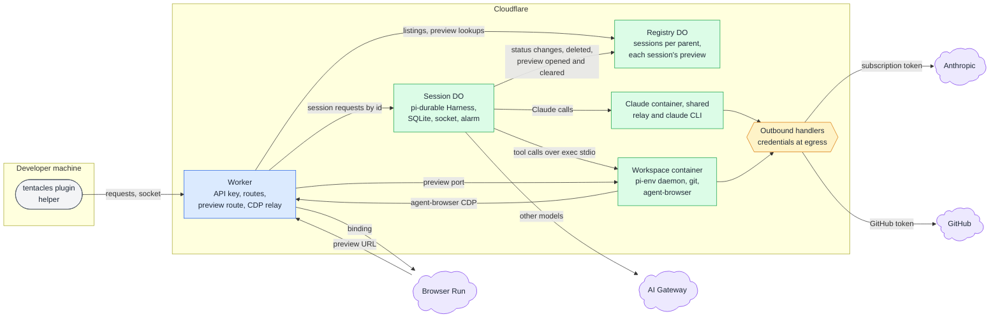
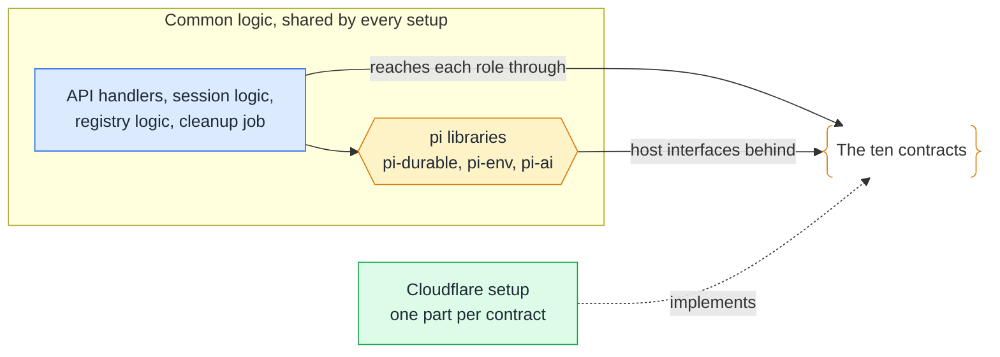

# Runtime components

## 🔭 Overview

tentacles runs on Cloudflare: one Worker as the only entry point, one registry Durable Object for everything that spans sessions, one session Durable Object per session running pi-durable, a workspace container per session for the agent's tools, and one Claude container shared by every session. Models other than Claude go through AI Gateway, and the agent's browser is a Browser Run browser reached through the Worker. No container holds a credential: outbound handlers add the Claude and GitHub tokens to requests as they leave. Each part fills a role that any provider could fill, and tentacles' shared logic reaches each role through a contract, so another setup can replace the infrastructure without changing the plugin.

## 🏗️ Architecture

### 🚪 Worker

The Worker is the only way in. It checks the API key on every plugin request and socket, then routes it: listings and preview lookups go to the registry, and everything about one session goes to that session's Durable Object by its id. It also hosts two routes of its own. The preview route turns a preview URL's token into a session and a port and forwards the request to that port in the workspace. The CDP relay connects agent-browser in the workspace to Browser Run through the binding. The Worker keeps no state of its own; the preview tokens live in the registry. [worker-api](worker-api.md) lists its calls and the session socket.

### 📒 Registry Durable Object

The registry is the one store that spans sessions: an entry per session with its name, its parent, its status and the time its last run stopped, plus the session's preview, when one is open: its port and its token. When the preview tool asks for a preview URL, the Worker generates the token and records it and the port on the session's entry, replacing any preview already open. When a run stops, the session tells the registry, which clears the session's preview. [sessions](sessions.md) lists the fields of each entry.

### 🧠 Session Durable Object

Each session is one Durable Object keyed by its session id. It runs pi-durable's Harness over its own SQLite, with the question tool and the `onWake` alarm that resumes a run after an eviction. It holds the parent's socket, which carries the session state on connect and on every change, and it owns its workspace container, which it starts on demand. It sends each model call where the session's settings say: Claude models to the shared Claude container, other providers to AI Gateway through `env.AI`. It tells the registry each time its status changes and when it is deleted.

### 📦 Workspace container

Each session has its own workspace container running pi-env's daemon and git, plus agent-browser when the image has it or the agent installs it. The session's tools reach the daemon over the container's exec stdio. [workspace](workspace.md) covers the container's start, lifetime and image.

### 🤖 Shared Claude container

One container runs pi-claude-code's relay and the claude CLI for every session, on the owner's Claude subscription. No session owns it: a model call from any session keeps it up, and it stops 15 minutes after the last call from any session.

> [!NOTE] Why the Claude container stops after 15 minutes
> Fifteen minutes outlasts Anthropic's five-minute prompt cache and the time a container takes to start, so a parent that prompts a session again soon after a run finishes reaches a container that is still up and a cache that is still warm.

### 🔐 Outbound handlers

Neither container holds a credential. The outbound handlers add the Claude subscription token to requests to Anthropic and the GitHub token to requests to github.com, on every request. Both tokens are Worker secrets, as is the API key.

All containers run in North America.

## 🔌 Provider-neutral roles

Each component above plays a role that any provider has to fill. Several roles already sit behind an interface the pi libraries define: pi-durable takes its storage and its wake-up timer from the host, pi-env runs tools over whatever connection it is given, and pi-ai reaches models through providers. The plugin talks only to the Worker API and the session socket, so it does not change with the provider.

| Role | On Cloudflare | Contract | Interface it builds on |
|---|---|---|---|
| Session host: one live instance per session, revived on demand | session Durable Object | `SessionHost` | pi-durable's Harness opens over any host |
| Session storage | Durable Object SQLite | `SessionStorage` | pi-durable's storage adapter |
| Wake-up timer | the object's alarm | `WakeTimer` | pi-durable's `onWake`; the host writes the timer |
| Parent socket | Durable Object WebSocket | `ParentChannel` | none |
| Registry of sessions and their preview | registry Durable Object | `RegistryStore` | none |
| Workspace: a container with exec | container started by the session object | `Workspace` | pi-env's `RemoteExecutionEnv` over a connection |
| Browser | Browser Run through the binding | `Browser` | agent-browser speaks CDP to any URL |
| Preview routing | Worker preview route and registry | `PreviewRouter` | none |
| Claude model relay | shared Claude container | `ModelRelay` | a pi-ai provider streaming over HTTP |
| Daily cleanup | Worker cron trigger | `Scheduler` | none |
| API entry: auth and routing | Worker | none, the Worker API itself | [worker-api](worker-api.md) |
| Other models | AI Gateway through `env.AI` | none | pi-ai providers |

A setup implements the ten contracts. The common logic (the API handlers, the session logic with its lifecycle, question tool, preview tool and deletion, the registry logic and the cleanup job) and the pi libraries are shared across setups. A setup is a set of parts chosen per role, so roles can come from different providers.

The pi libraries node is the set of pi libraries the common logic uses: pi-durable, pi-env and pi-ai.

> [!NOTE] Why credentials are not a contract
> Keeping credentials out of containers is how the Cloudflare setup implements `Workspace` and `ModelRelay`, through its outbound handlers. Another setup keeps them out in its own way, so the shared logic never sees a credential and has nothing to ask a contract for.

> [!NOTE] Where the contracts come from
> The contracts follow the roles and the host interfaces pi already defines, not any infrastructure library. A role pi already abstracts, such as storage or the wake-up timer, takes pi's interface as its contract's shape.

## 🧩 Provider contracts

Each contract covers one role from the table above:

- `SessionHost`: keeps one live instance per session and revives it on demand.
- `SessionStorage`: stores a session's pi-durable history and tentacles' record.
- `WakeTimer`: wakes a session to resume a run after an eviction.
- `ParentChannel`: holds the parent's socket and sends it the session state.
- `RegistryStore`: stores the entries that span sessions, each with its session's preview.
- `Workspace`: starts a session's container and runs commands in it.
- `Browser`: gives agent-browser a browser to connect to.
- `PreviewRouter`: turns a preview URL into a session and a port and forwards requests to it.
- `ModelRelay`: carries Claude model calls to Anthropic.
- `Scheduler`: runs the daily cleanup job.

What each contract exposes is not defined yet. Each definition gets added to this section once it is settled.

---

Related: [sessions](sessions.md), [worker-api](worker-api.md), [workspace](workspace.md), [question-round-trip](question-round-trip.md), [plugin](plugin.md)
