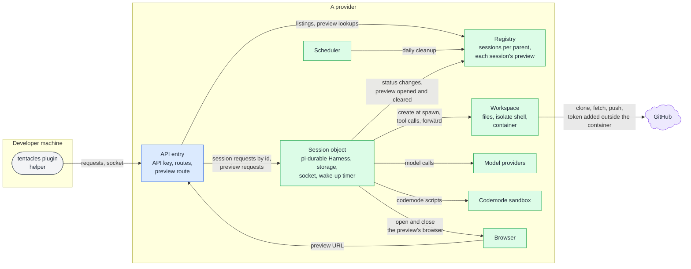
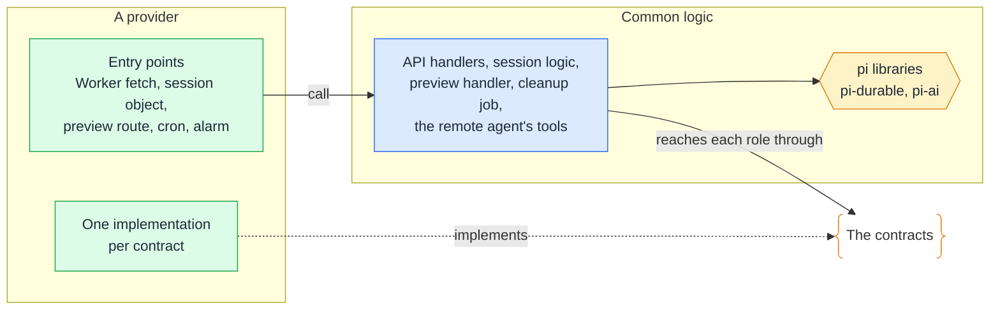

# Runtime components

## 🔭 Overview

tentacles runs as a set of roles: an API entry that is the only way in, a registry for everything that spans sessions, one session object per session running pi-durable, a workspace per session that holds the agent's files and runs its commands, model providers, a codemode sandbox, a managed browser for previews and a daily scheduler. tentacles' shared logic reaches each role through a contract, and a provider fills every contract, so another setup can replace the infrastructure without changing the plugin. No container holds a credential: the provider adds the tokens to requests outside the container. Cloudflare is the first provider; [deploy](providers/cloudflare/deploy.md) covers how it fills each role.

## 🏗️ Architecture

The **API entry** checks the API key on every plugin request and socket, then routes it: listings and preview lookups go to the registry, and everything about one session goes to that session's object by its id. Its preview route turns a preview URL's token into a session and a port and hands the request to the session object. [worker-api](worker-api.md) lists its calls and the session socket.

The **registry** is the one store that spans sessions: an entry per session with its name, its parent, its status, the time its last run stopped, its settings and skill and agent names, and the session's preview while one is open. [sessions](sessions.md) lists the fields of each entry.

The **session object** is one live instance per session, keyed by its session id. It runs pi-durable's Harness over its own storage, with the question tool and the wake-up timer that resumes a run after an eviction. It creates the session's workspace at spawn and installs the tools the workspace returns, holds the parent's socket, sends each model call to the provider the settings name, and opens and closes the preview's browser. It never writes the status ahead of the run: it watches pi-durable's state and tells the registry each time the derived status changes.

The **workspace** holds the session's files under `/workspace` and runs the agent's commands on the cheapest backend that can run them, the isolate shell or the container. Its git reaches GitHub with the token added outside the container. [workspace](workspace.md) covers its contract, setup and tools.

The **model providers**, the **codemode sandbox**, the **browser** and the **scheduler** each answer one kind of call: a model call, a codemode script, opening or closing the preview's browser, and firing the daily cleanup job.

## 🔌 Provider-neutral roles

Each component above plays a role that any provider has to fill. Several roles already sit behind an interface the pi libraries define: pi-durable takes its storage, its wake-up timer and its tools from the host, and pi-ai reaches models through providers. The plugin talks only to the Worker API and the session socket, so it does not change with the provider.

| Role | Contract | What the common logic asks it | Interface it builds on |
|---|---|---|---|
| Session host: one live instance per session, revived on demand | `SessionHost` | reach a session by id and run one of its operations: create, prompt, answer, close, messages, status, connect a socket, forward a preview request, delete | pi-durable's Harness opens over any host |
| Session storage | `SessionStorage` | pi-durable's storage for one session | pi-durable's storage adapter |
| Wake-up timer | `WakeTimer` | set or clear the one timer that resumes a run after an eviction | pi-durable's `onWake`; the host writes the timer |
| Parent socket | `ParentChannel` | send the session state to every socket the parent holds open | none |
| Registry of sessions and their preview | `RegistryStore` | add an entry, record a status and the time a run stops, list one parent's sessions, open a preview and return its token, resolve and clear a preview, remove an entry, find the sessions stopped before a given time | none |
| Workspace: the session's files and the backends that run its commands | `Workspace` | `create(init)`: set up the workspace at spawn from the repository URL or none, the git identity, the container's size and image, and the skills and context archives, and return the tools the harness installs, each with its replay policy and its own execute; `forward`: hand a preview request to a port and return the app's answer, 502 when nothing listens | pi-durable's tool registrations |
| Browser | `Browser` | open a browser for the session's preview, returning the CDP URL agent-browser connects to, and close it | agent-browser speaks CDP to any URL |
| Preview routing | `PreviewRouter` | the public URL a preview token is served on | none |
| Models | `ModelProviders` | every model provider the session's settings can name | pi-ai providers |
| Daily cleanup | `Scheduler` | run a job once a day | none |
| Codemode sandbox | `CodeSandbox` | the sandbox codemode scripts run in | pi-durable's codemode sandbox |
| API entry: auth and routing | none, the Worker API itself | nothing: the API entry runs the API handlers | [worker-api](worker-api.md) |

A provider implements every contract in the table. The common logic (the API handlers, the session logic with its lifecycle and deletion, the preview handler, the cleanup job and the remote agent's tools other than the workspace's) and the pi libraries are the same for every provider. A deploy uses one provider for every role, and a variable read by the deploy picks the provider. [providers](providers/README.md) lists the providers.

The calls run both ways. The provider receives every outside event (the API requests, the preview route, the cron trigger and the alarm) and calls the common logic. Each session object hosts its session's logic. The common logic calls the provider only through the contracts. `SessionHost` goes both ways: the provider hosts each session, and the common logic reaches a session by its id through it.

> [!TIP] Considered and not taken: roles from different providers in one deploy
> On Cloudflare one session object fills five roles (`SessionHost`, `SessionStorage`, `WakeTimer`, `ParentChannel`, and `Workspace`, whose files and container live in it), so a role taken from another provider would have to split that object apart. One provider per deploy keeps each provider's parts together.

> [!NOTE] Why credentials are not a contract
> Keeping credentials out of containers is how a provider implements `Workspace` and `ModelProviders`: it adds the tokens to requests outside the container, in its git client and at egress. Each provider keeps them out in its own way, so the shared logic never sees a credential and has nothing to ask a contract for.

> [!NOTE] Where the contracts come from
> The contracts follow the roles and the host interfaces pi already defines, not any infrastructure library. A role pi already abstracts, such as storage, the wake-up timer or the agent's tools, takes pi's interface as its contract's shape.

## 🧩 Provider contracts

Each contract in the table under 🔌 Provider-neutral roles is an Effect service, and each provider supplies its implementation as a Layer. The common logic asks for a contract and never names a provider.

Shapes the API defines, such as the session state, pass through the contracts with the types the API declares, so a contract and the API cannot disagree.

A member that can fail declares a tagged error with a message: `Workspace.create` fails with the setup error, `Browser.open` with `BrowserUnavailable`, and every `RegistryStore` member with `RegistryUnavailable`. The common logic handles each by its tag: a failed `create` marks the session failed and create answers the parent with the error, the preview tool closes the browser it opened when the registry fails, and the cleanup job logs a registry failure.

> [!NOTE] Why the roles pi already defines get contracts of their own
> Storage, the wake-up timer, the agent's tools and the model providers already have interfaces in pi, and their contracts often hand pi's object through unchanged. Every role gets a contract anyway, so all roles are defined one way, and a reader and a new provider find every contract in the same form.

A provider is one package that declares its own infrastructure. It exports a stack, which a deploy runs with Alchemy on the stage `prod`. The stack declares the provider's resources, and the code that runs in those resources builds the Layer of the contracts from the same declarations.

> [!NOTE] Why each implementation declares its own infrastructure
> A provider plugs an implementation in once, and both the running code and the deploy use it. When the declaration of a resource and the code that uses it are the same code, a resource the code needs cannot be missing from the deploy.

---

Related: [sessions](sessions.md), [worker-api](worker-api.md), [workspace](workspace.md), [question-round-trip](question-round-trip.md), [plugin](plugin.md), [providers](providers/README.md), [deploy](providers/cloudflare/deploy.md)
