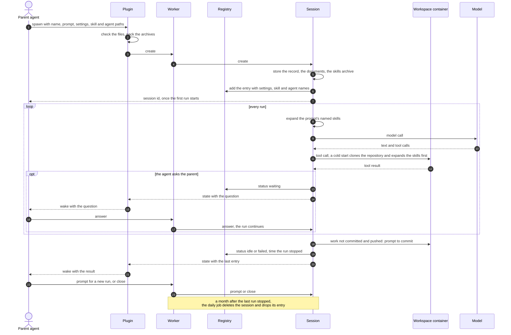
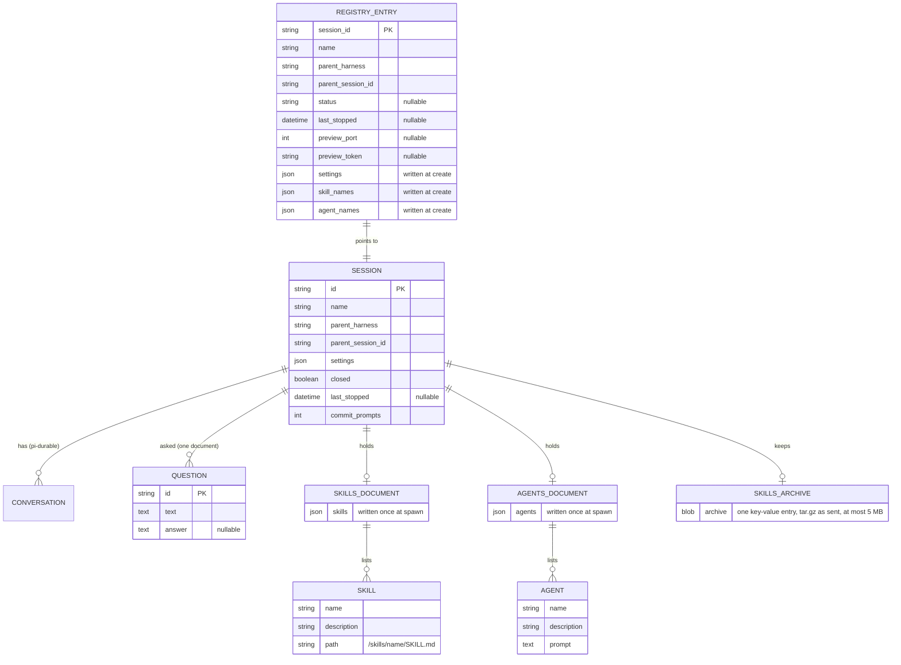
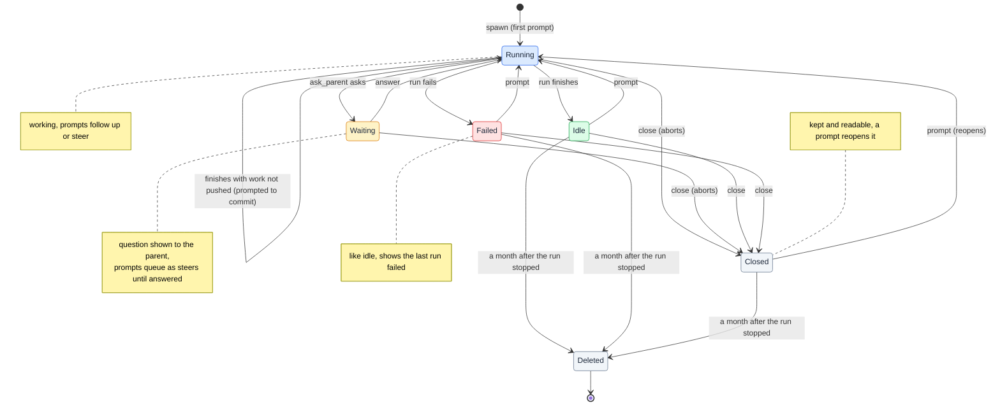
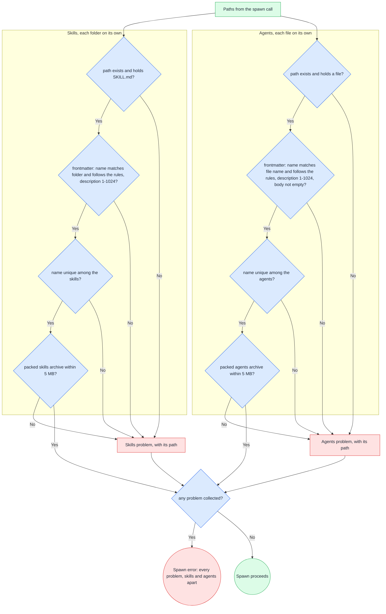
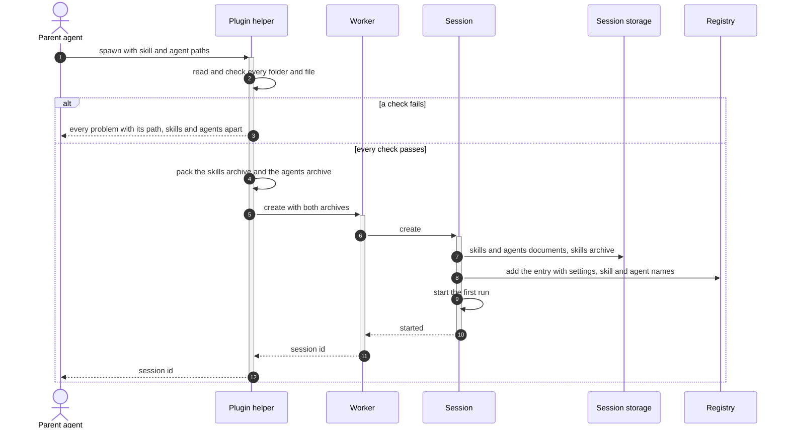
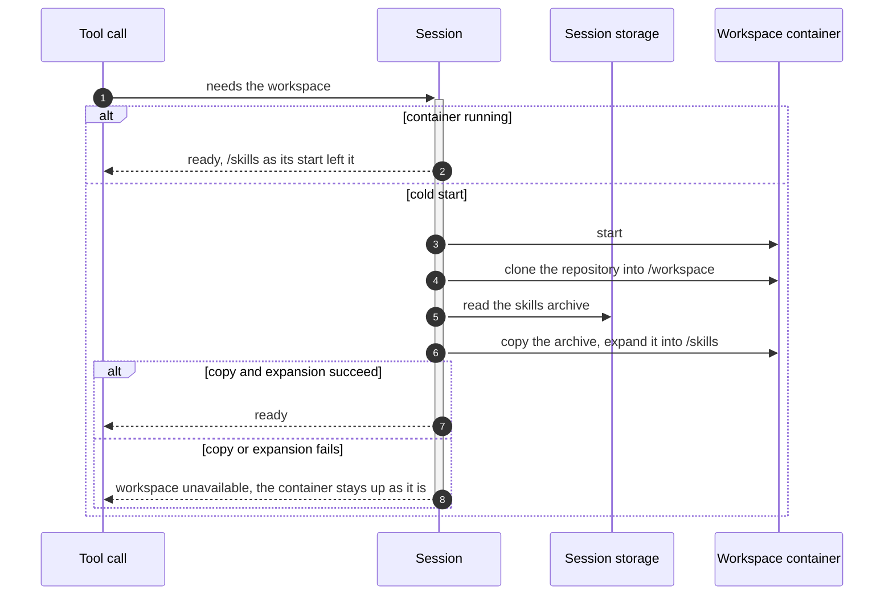
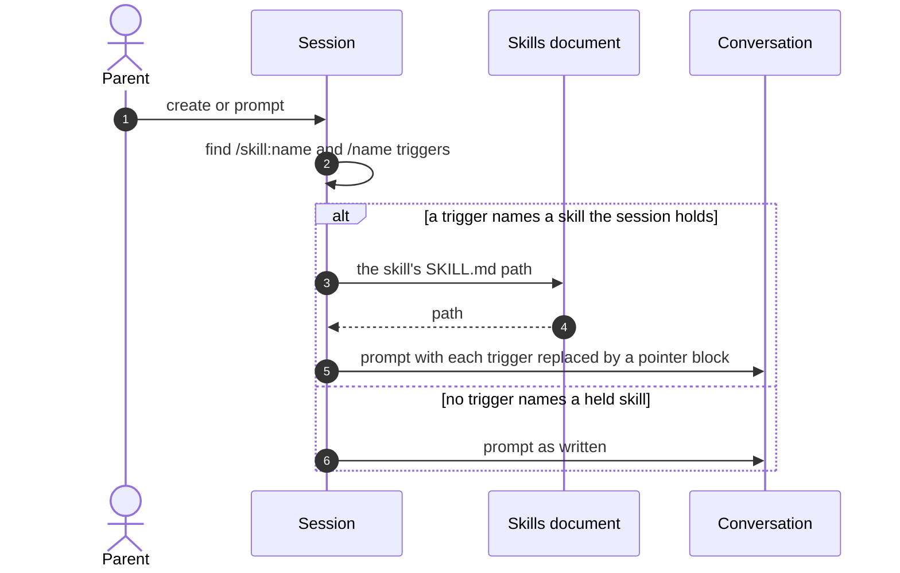
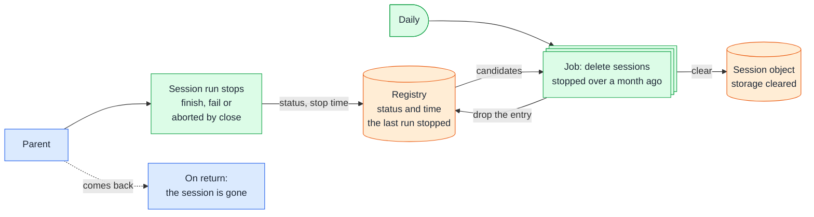

# Sessions

## 🔭 Overview

A session is one remote agent: a Durable Object keyed by its session id, where pi-durable keeps its conversations and tentacles keeps a record of who started it, with which settings, and in what state it is. A registry Durable Object keeps one entry per session so the list call returns a parent's sessions with their status in one call. A session starts running at spawn, goes idle or failed when a run stops, waits while its agent asks a question, and stays readable after it is closed. A session also carries the skills and agent definitions its parent sent at spawn, which its agent finds by name. A daily job deletes every session whose last run stopped more than a month ago.

## 🗺️ A session from spawn to deletion



The parent spawns with a name, a first prompt, its settings and any skill and agent paths (1). The plugin checks the skill and agent files and packs them into two archives (2), and sends create through the Worker to a new session (3, 4). The session stores its record, its skills and agents documents and the skills archive (5), adds its registry entry (6), and answers with its id once the first run has started (7).

In every run, the session expands any skill the prompt names (8), sends the conversation to the model (9, 10) and runs the tools the model calls in the workspace container (11, 12); the first tool call after a cold start finds the repository cloned and the skills expanded ([workspace](workspace.md)). When the agent asks the parent, the session waits, the plugin wakes the parent with the question and the answer continues the run (13 to 17; [question-round-trip](question-round-trip.md)).

When a run ends, the session prompts the agent to commit any work not pushed (18), records the new status and the time the run stopped in the registry (19), and sends the state with the run's last entry, which the plugin turns into a wake (20, 21). A prompt starts a new run and close stops the session (22, 23; [worker-api](worker-api.md)). A month after the last run stopped, the daily job deletes the session (see Daily cleanup below).

## 💽 Modeling



pi-durable's conversations (the root, its forks and subagent conversations) live inside the session object as pi-durable stores them. tentacles adds the other entities.

### 🧠 Session

SESSION is the record each session's Durable Object keeps next to pi-durable's history. `id` is the session id the object is keyed by. `name` is required and given by the parent at spawn; it is what the parent's status line shows. `parent_harness` (pi or claude) and `parent_session_id` identify the parent: its harness and that harness's session id. `settings` holds what the parent chose at spawn, with the plugin's defaults for anything the parent left out: provider, model, effort level, image, size and lifetime, and optionally the repository tentacles clones into the workspace. close sets `closed`, and a prompt that reopens the session clears it. `last_stopped` is the time the session's last run stopped, and is empty while the first run is going. The 15 minutes that pending work keeps the container up count from this time (see [workspace](workspace.md)). `commit_prompts` counts the prompts to commit sent in the current run, so the limit of three survives an eviction; a run started by a prompt from the parent resets `commit_prompts` to zero.

The session state it sends the parent also carries its settings and the names of its skills and agents.

The session's status is not a field. The session object watches pi-durable's state and derives it: a run going is running, an unanswered question is waiting, no run with `closed` set is closed, no run with the last run's failure recorded is failed (pi-durable keeps why the run failed), and no run otherwise is idle. Each time the derived status changes, the session reports it to the registry and sends the session state to the parent, so a status always follows something the session did.

### 📒 Registry entry

REGISTRY_ENTRY lives in the one registry Durable Object for the whole Worker, one entry per session: the session id, its name, the parent's harness and session id, the session's status (the same values as the session's derived status, closed included, and empty until the session reports its first one) and `last_stopped`, the time the last run stopped. When the session adds its entry at create, it also writes three values that never change: `settings`, and `skill_names` and `agent_names`, the names of the skills and agent definitions its spawn sent, which it reads from the archives. The registry records `last_stopped` itself when a status change reports a stopped run, keeps it when one stopped status follows another, and clears it when a new run starts. The session updates its entry on every state change, so the list call and the plugin's start-up sync get each session's status without asking each session. The daily cleanup job picks its candidates from the registry's `last_stopped`, and drops the entry after it deletes the session.

`preview_port` and `preview_token` hold the session's preview while one is open, and are empty otherwise. A session has at most one preview, and only to validate the app in a Browser Run browser; the agent validates anything else, such as an API, inside the workspace with no preview. `preview_port` is the workspace port the preview exposes. `preview_token` is a random UUID that the registry generates when the preview tool opens a preview. It is the only value the registry returns for the new preview, so a preview URL carries neither the API key nor the session id. Opening a preview while one is open replaces it: the previous token stops working and its browser closes. When the run stops, the registry clears both fields. [workspace](workspace.md) covers how the agent opens and uses a preview.

> [!TIP] Rejected: listing the session Durable Objects directly
> Durable Objects cannot be enumerated or queried across instances, so "the sessions of this parent" has no answer without a store that spans sessions. The registry is that store, and holding the status there spares the plugin one status call per session.

### ❓ Question

QUESTION is a question the session's agent asked with `ask_parent`: its id, its text and its answer, empty until the parent answers. Every question of the session lives in one session-wide document, one entry per question, and an entry stays after its answer. The id is the id of the asking tool call. When an eviction makes the tool run again, the replay finds its question in the document and keeps the id. If the answer already arrived, the replay returns the answer without asking again. The waiting question is the one with no answer whose tool call is still live; an aborted or finished call takes its question out of waiting. [question-round-trip](question-round-trip.md) follows the question to the parent and back.

### 📚 Skills and agents documents and the skills archive

A skill is a folder that holds a SKILL.md and whatever the skill points to. An agent definition is a file whose frontmatter names a subagent and whose body is that subagent's prompt. The skills document and the agents document are pi-durable documents of the session, written once at spawn. A skill entry holds the skill's name and description, which the prompt lists. It also holds the full path of its SKILL.md in the workspace, which the skill tool and a prompt expansion point the agent to. An agent entry holds the agent's name, description and prompt, which the subagent tool starts a subagent with. Agent definitions live only here and never enter the container.

SKILLS_ARCHIVE is the skills archive exactly as the spawn sent it. The session object stores it as one value under a fixed key in its key-value storage, which lives in the same SQLite database as pi-durable's tables. Only a container start reads it. Deleting the session clears the documents and the archive with the rest of its storage.

The API key and the Claude and GitHub credentials are Worker secrets, and none of these entities stores them.

## 🟢 Lifecycle



A session starts running when the parent spawns it, since spawn carries the first prompt; the session stores the skills and agent definitions the spawn sent before the run starts. While it runs, a prompt from the parent follows up or steers. An eviction is not a state: pi-durable resumes the run by the session's alarm and the session stays running.

When the agent asks a question, after committing and pushing its work, the session waits. The conversation cannot continue until the parent answers. A prompt sent meanwhile is a steer whatever its mode, and reaches the agent after the answer; it neither answers nor cancels the question.

A run ends in one of two ways. When it finishes, the session is idle. When the session's settings name a repository and that repository holds work not committed and pushed, tentacles first prompts the agent to commit and the run goes on, up to three times (see [workspace](workspace.md)). When the run fails on an error it cannot recover from, the session is failed: it behaves like idle and records why the last run failed. The plugin notifies the parent either way, and a prompt on either starts a new run. The session's preview, if one is open, closes when a run stops.

close aborts whatever the session is doing and leaves it closed: kept in its Durable Object, where its history and state stay readable until it is deleted. close sets `closed` and aborts any run; the status turns closed once the session sees no run and `closed` set, at once for an idle or failed session. A prompt on a closed session clears `closed` and starts a new run, whether sent as a follow-up or a steer, and the status leaves closed once the run starts.

The month before deletion counts from when the last run stops: when it finishes, fails or is aborted by close. Closing a session that is already idle or failed aborts no run, so its month keeps counting from when its last run stopped. A session is never deleted while a run is going, including while a question waits inside it, and reading a session (its messages, its status, a socket connecting) does not renew the month.

## 🧩 Skills and agents

### 🏗️ Which conversations get them

```mermaid
flowchart LR
    subgraph root["Root conversation"]
        R1@{ shape: rect, label: "Coding tools, codemode,<br/>commit check, preview" }
        R2@{ shape: rect, label: "Skills extension<br/>document, section, skill tool" }
        R3@{ shape: rect, label: "Agents extension<br/>document, section, subagent tool" }
        R4@{ shape: rect, label: "Root extension<br/>question tool, tentacles instructions" }
    end
    subgraph child["Child"]
        C1@{ shape: rect, label: "Coding tools, codemode,<br/>commit check, preview" }
        C2@{ shape: rect, label: "Skills extension" }
        C3@{ shape: rect, label: "Agents extension" }
    end
    subgraph grand["Grandchild"]
        G1@{ shape: rect, label: "Coding tools, codemode,<br/>commit check, preview" }
        G2@{ shape: rect, label: "Skills extension" }
    end
    root -->|"spawns, keeps all but the root extension"| child
    child -->|"spawns, also drops the agents extension"| grand
    classDef green fill:#dcfce7,stroke:#16a34a,color:#1f2937
    classDef amber fill:#fef3c7,stroke:#d97706,color:#1f2937
    class R1,C1,G1 green
    class R2,R3,R4,C2,C3,G2 amber
```



Skills and agents are each one pi-durable extension that owns its document, its prompt section and its tool. Every conversation in a session gets the skills extension: the root, its children and their children. The root and its children also get the agents extension, so a child can spawn subagents of its own; a grandchild cannot. Only the root carries the question tool and tentacles' own instructions. An extension leaves its section out of the prompt when the section has nothing to list.

> [!NOTE] Why skills and agents are extensions of their own
> Only the skill tool, the subagent tool and their sections read the skills and agents, and they never change after spawn, while the session record gets a new revision at every run end. A document owned by each extension keeps them out of the record's revisions and lets either extension be taken out without touching the record.

### 🚀 What a spawn sends

The parent passes skill folder paths and agent definition paths to the spawn tool, on pi and on Claude Code alike. The plugin's helper reads every path, checks every file, and packs two archives, each a gzip-compressed tar file of at most 5 MB:

- The skills archive holds one folder per skill at its top level: `<name>/SKILL.md` and everything beside it.
- The agents archive holds one agent definition file per agent at its top level, named `<name>.md` after the agent.

Each file keeps its permission bits, so a skill's executable scripts stay executable in `/skills`.

Both are optional, and a spawn can send either one without the other. The create call carries them next to the name, the parent, the settings and the first prompt (see [worker-api](worker-api.md)).



The helper checks the skills and the agents apart, every file on its own, and keeps going after a problem so it reports them all. A skill follows the Agent Skills specification. Its name is 1 to 64 lowercase letters, digits and hyphens, with no leading, trailing or doubled hyphen, and equals its folder's name. Its description is 1 to 1024 characters. An agent definition is a file whose frontmatter name and description follow the same rules as a skill's, whose name equals the file's name without `.md`, and whose body is not empty. Names are unique within each group, and each packed archive stays within 5 MB. When anything fails, the spawn tool returns every problem with its path, the skills' in one group and the agents' in another, and nothing reaches tentacles.

Frontmatter is read as YAML. A top-level value on one line that YAML rejects as written, such as a description holding `: `, is read as a quoted string. The helper then packs the file with that value quoted, so the session reads valid frontmatter. Frontmatter that is still not valid YAML is a problem with its path.

> Definitions written for other assistants often carry such values, and those assistants accept them. Reading them as quoted strings keeps those definitions usable without editing them.

The session takes these values from an agent definition:

| From the file | Becomes |
|---|---|
| frontmatter `name` | the agent's name, verbatim |
| frontmatter `description` | the agent's description, verbatim |
| the body | the agent's prompt, verbatim, without the frontmatter |
| any other frontmatter field, such as tools, model, skills, color or permissionMode | nothing |

Every subagent gets the session's model and the tools of its level in the session, whatever its definition declares.

### 📩 How the skills move

#### 🧳 At spawn



The parent calls the spawn tool with paths (1). The plugin's helper reads and checks every folder and file (2). On any failure, the helper returns every problem as the spawn tool's result and sends nothing (3). Otherwise it packs the skills archive and the agents archive (4) and sends create with them (5), which the Worker hands to the session (6). The session reads both archives again to build the skills and agents documents and stores the skills archive unchanged (7). When it cannot read an archive, create returns an error naming the archive and the problem, and the session stores nothing (see [worker-api](worker-api.md)). It adds its registry entry with the settings and the skill and agent names it read (8), and only then starts the first run (9). create answers with the session id once the run has started (10 to 12).

#### 📦 At every container start



Before a tool uses the workspace, the session makes sure the container is up (1). A running container already holds whatever its start put in `/skills` (2). On a cold start, the first one or one after an eviction, the session starts the container (3) and clones the repository when the settings name one (4). It then reads the skills archive from its storage (5), copies it into the container and expands it into `/skills`, one folder per skill (6), and the tool runs (7). A failed copy or expansion fails the workspace the way a failed clone does (8). The tool call that needed the workspace fails with "workspace unavailable". The container stays running, so later tool calls use it without the repository or the skills that failed to arrive. Nothing clones or expands again until the container next starts cold. Rendering the prompt's sections never starts the container. The session passes the archive as the standard input of a command it runs in the container, and the image's `tar` expands it there. [workspace](workspace.md) covers the rest of the container's start.

> [!NOTE] Why the session keeps the archive whole
> Only the container uses the skills' files, and it needs all of them at once. The session keeps the archive as it arrived and lets the container's own `tar` expand it, so the files move in one copy and the session never handles them one by one.

#### 💬 In a prompt that names a skill



The session expands every prompt, the first one included, before the conversation admits it (1, 2). `/skill:<name>` and `/<name>` name a skill when the word after the slash is one of the session's skill names and the trigger stands on its own, with whitespace or the start or end of the text on each side. For each one, the session takes the skill's path from the skills document (3, 4) and replaces the `/skill:<name>` or `/<name>` in place with a block that points at the skill (5); a skill named twice gets a block at each one. A prompt with no such name reaches the conversation as written (6), and so does any `/word` that names no skill, sits inside a path or has punctuation attached. The conversation keeps the expanded prompt, so the session's messages show what the agent saw.

The prompt "Run /implement on the api repo" reaches the agent as:

```text
Run <skill name="implement" location="/skills/implement/SKILL.md">
Read /skills/implement/SKILL.md before acting on this skill. Paths it names, such as references/ or scripts/, are relative to /skills/implement/.
</skill> on the api repo
```

> [!NOTE] Why the block points at the skill instead of holding it
> The agent reads SKILL.md with its read tool when it acts on the block, the same way it reads the files the skill refers to. The block stays a few lines whatever the skill's size, and expanding a prompt reads nothing but the skills document.

### ♠️ What they expose

| Member | Answers | Who asks |
|---|---|---|
| skills section | each skill's name and description, and that the skill tool loads one | the model, in every conversation, when the session holds skills |
| skill tool | given a skill name, the same pointer block a prompt expansion adds; an unknown name fails the call, naming the skills that exist | the model, when a task matches a listed skill |
| agents section | each agent's name and description, and how to spawn one with the subagent tool | the model, in the root and its children, when the session holds agents |
| subagent tool, run and spawn | an optional agent name: with one, the subagent starts with that agent's prompt as its instructions; an unknown name fails the call, naming the agents that exist | the model, in the root and its children |

Without an agent name, run starts the subagent with no instructions of its own, and spawn starts it with a line giving the subagent's name.

> [!WARNING] A skill that names a skill the session does not hold
> Skills often load other skills by name, sometimes with a plugin prefix such as `plugin:skill`, and refer to their own files through variables such as `${CLAUDE_PLUGIN_ROOT}`. tentacles resolves neither. The model works them out from the listing and the `/skills/<name>/` layout, and a skill the parent did not send is missing: the agent finds no such name and carries on without it.

## 🧹 Daily cleanup



A job runs once a day through the `Scheduler` contract; on Cloudflare a cron trigger on the Worker fires it (see [runtime-components](runtime-components.md)). It reads the registry and picks the sessions whose last run stopped more than a month ago. A running or waiting session is never a candidate. For each candidate it deletes the session through its Durable Object, which clears the object's storage, removing its history, its record and its skills and agent definitions, and then drops the registry entry. The entry goes only after the session is gone, so a deletion that stopped halfway leaves the session a candidate, and the next day's job deletes it again and drops the entry. No preview is left by then, since the preview closes when a run stops. Nothing outside tentacles is touched: branches the agent pushed stay on GitHub.

tentacles does not tell the parent. The parent's plugin removes the session from its local list the first time it learns of the deletion (see [plugin](plugin.md)).

The session's alarm belongs to pi-durable, which uses it only to resume a run after an eviction. Nothing else schedules on it.

> [!TIP] Rejected: scheduling each session's deletion on its own alarm
> A Durable Object has one alarm, and pi-durable writes it and deletes it as runs start and end: after a run ends, the host clears it, and a new instance replaces it. A deletion written to the same alarm would be lost the first time a run stopped, and the alarm handler could not tell a due deletion from a resume. A daily job over the registry keeps the two apart.

---

Related: [runtime-components](runtime-components.md), [worker-api](worker-api.md), [question-round-trip](question-round-trip.md), [workspace](workspace.md), [plugin](plugin.md), [remote-agents](../product-design/remote-agents.md)
