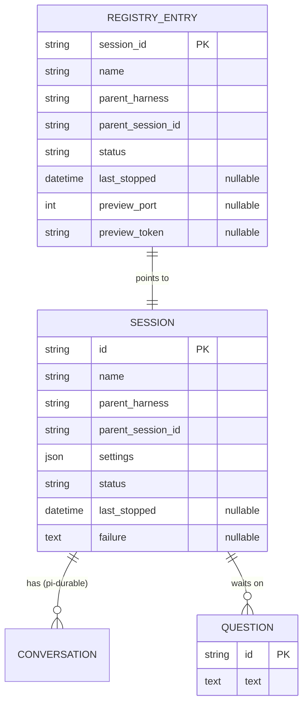
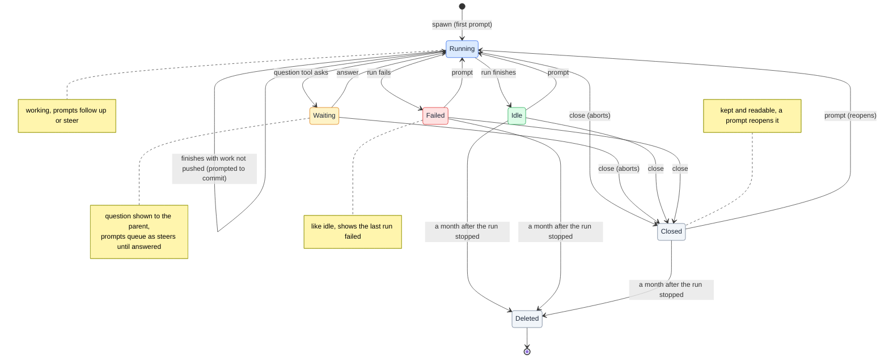
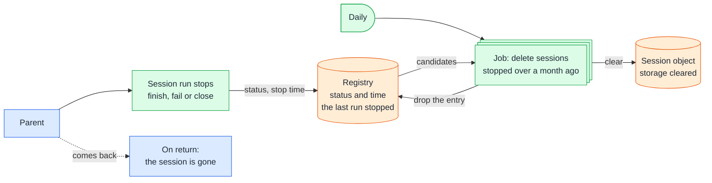

# Sessions

## 🔭 Overview

A session is one remote agent: a Durable Object keyed by its session id, where pi-durable keeps its conversations and tentacles keeps a record of who started it, with which settings, and in what state it is. A registry Durable Object keeps one entry per session so the list call returns a parent's sessions with their status in one call. A session starts running at spawn, goes idle or failed when a run stops, waits while its agent asks a question, and stays readable after it is closed. A daily job deletes every session whose last run stopped more than a month ago.

## 💽 Modeling

pi-durable's conversations (the root, its forks and subagent conversations) live inside the session object as pi-durable stores them. tentacles adds the other three entities.

### 🧠 Session

SESSION is the record each session's Durable Object keeps next to pi-durable's history. `id` is the session id the object is keyed by. `name` is required and given by the parent at spawn; it is what the parent's status line shows. `parent_harness` (pi or claude) and `parent_session_id` identify the parent: its harness and that harness's session id. `settings` holds what the parent chose at spawn, with the plugin's defaults for anything the parent left out: provider, model, effort level, image, size and lifetime, and optionally the repository tentacles clones into the workspace. `status` holds the state described in the Lifecycle section below, closed included. `last_stopped` is the time the session's last run stopped, from which the month before deletion counts, and is empty while the first run is going. `failure` describes why the last run failed and is empty unless the session is failed.

### 📒 Registry entry

REGISTRY_ENTRY lives in the one registry Durable Object for the whole Worker, one entry per session: the session id, its name, the parent's harness and session id, the session's status (the same values as the session's own status, closed included) and `last_stopped`, the same stop time the session keeps. The session updates its entry on every state change, so the list call and the plugin's start-up sync get each session's status without asking each session. The daily cleanup job picks its candidates from `last_stopped`. The registry drops the entry when the session is deleted.

`preview_port` and `preview_token` hold the session's preview while one is open, and are empty otherwise. A session has at most one preview, and only to validate the app in a Browser Run browser; the agent validates anything else, such as an API, inside the workspace with no preview. `preview_port` is the workspace port the preview exposes. `preview_token` is a random UUID the Worker generates when the preview tool asks for it, so a preview URL carries neither the API key nor the session id. Opening a preview while one is open replaces it: the previous token stops working and its browser closes. When the run stops, the registry clears both fields. [workspace](workspace.md) covers how the agent opens and uses a preview.

> [!TIP] Rejected: listing the session Durable Objects directly
> Durable Objects cannot be enumerated or queried across instances, so "the sessions of this parent" has no answer without a store that spans sessions. The registry is that store, and holding the status there spares the plugin one status call per session.

### ❓ Question

QUESTION is a question the session's agent is waiting on: its id and its text, nothing more. It exists from the moment the question tool asks until the answer resolves the tool call. It keeps its id when an eviction makes the tool run again. [question-round-trip](question-round-trip.md) follows the question to the parent and back.

The API key and the Claude and GitHub credentials are Worker secrets, and none of these entities stores them.

## 🟢 Lifecycle

A session starts running when the parent spawns it, since spawn carries the first prompt. While it runs, a prompt from the parent follows up or steers. An eviction is not a state: pi-durable resumes the run by the session's alarm and the session stays running.

When the agent asks a question, after committing and pushing its work, the session waits. The conversation cannot continue until the parent answers. A prompt sent meanwhile queues as a steer and reaches the agent after the answer; it neither answers nor cancels the question.

A run ends in one of two ways. When it finishes, the session is idle. When the session's settings name a repository and that repository holds work not committed and pushed, tentacles first prompts the agent to commit and the run goes on, up to three times (see [workspace](workspace.md)). When the run fails on an error it cannot recover from, the session is failed: it behaves like idle and records why the last run failed. The plugin notifies the parent either way, and a prompt on either starts a new run. The session's preview, if one is open, closes when a run stops.

close aborts whatever the session is doing and leaves it closed: kept in its Durable Object, where its history and state stay readable until it is deleted. A prompt on a closed session reopens it and starts a new run, whether sent as a follow-up or a steer, and the registry status leaves closed.

The month before deletion counts from when the last run stops, by finishing, failing or close. A session is never deleted while a run is going, including while a question waits inside it, and reading a session (its messages, its status, a socket connecting) does not renew the month.

## 🧹 Daily cleanup

A job runs once a day through the `Scheduler` contract; on Cloudflare a cron trigger on the Worker fires it (see [runtime-components](runtime-components.md)). It reads the registry and picks the sessions whose last run stopped more than a month ago. A running or waiting session is never a candidate. For each candidate it clears the session's Durable Object, removing its history and record, and drops its registry entry. No preview is left by then, since the preview closes when a run stops. Nothing outside tentacles is touched: branches the agent pushed stay on GitHub.

tentacles does not tell the parent. The parent's plugin removes the session from its local list the first time it learns of the deletion (see [plugin](plugin.md)).

The session's alarm belongs to pi-durable, which uses it only to resume a run after an eviction. Nothing else schedules on it.

> [!TIP] Rejected: scheduling each session's deletion on its own alarm
> A Durable Object has one alarm, and pi-durable writes it and deletes it as runs start and end: after a run ends, the host clears it, and a new instance replaces it. A deletion written to the same alarm would be lost the first time a run stopped, and the alarm handler could not tell a due deletion from a resume. A daily job over the registry keeps the two apart.

---

Related: [runtime-components](runtime-components.md), [worker-api](worker-api.md), [question-round-trip](question-round-trip.md), [workspace](workspace.md), [plugin](plugin.md), [remote-agents](../product-design/remote-agents.md)
