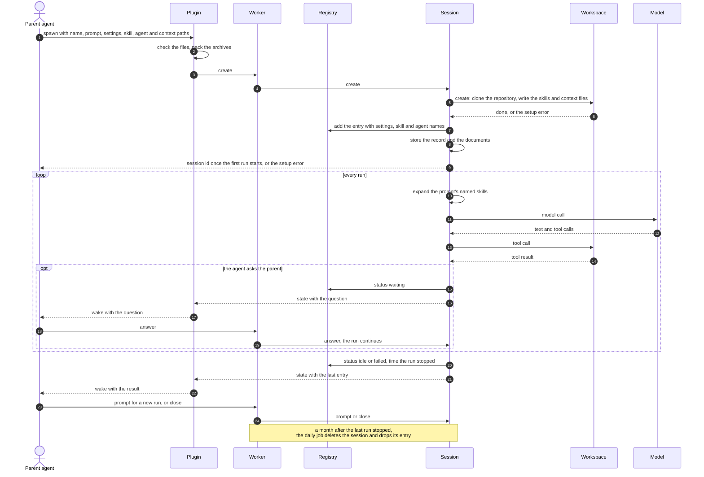
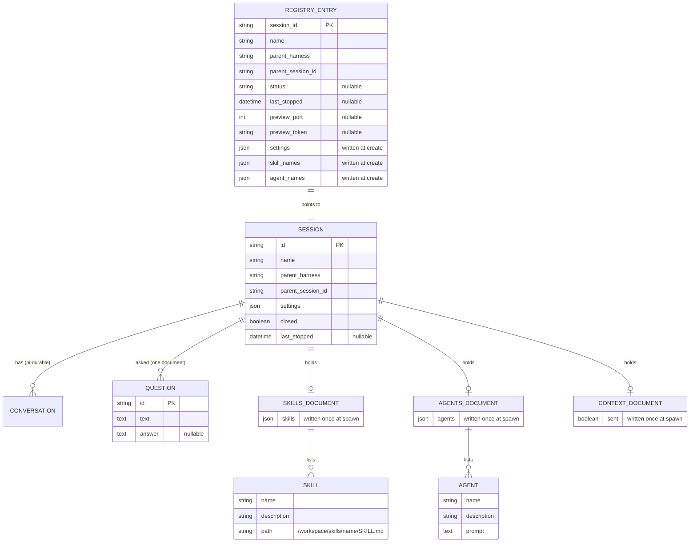
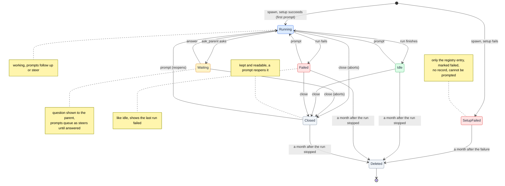
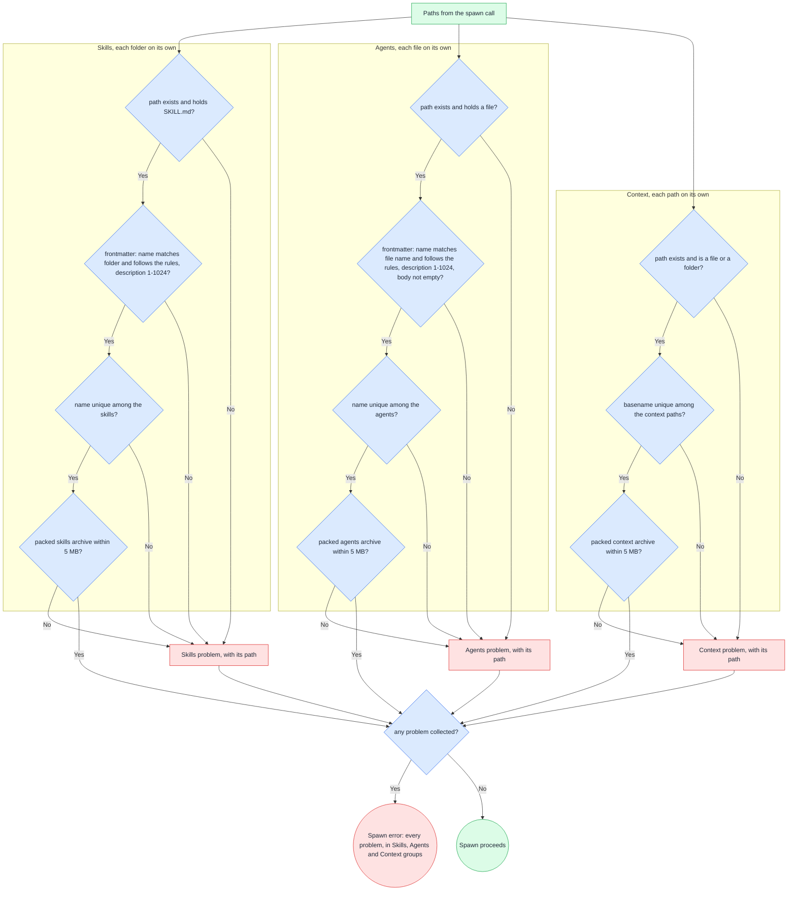
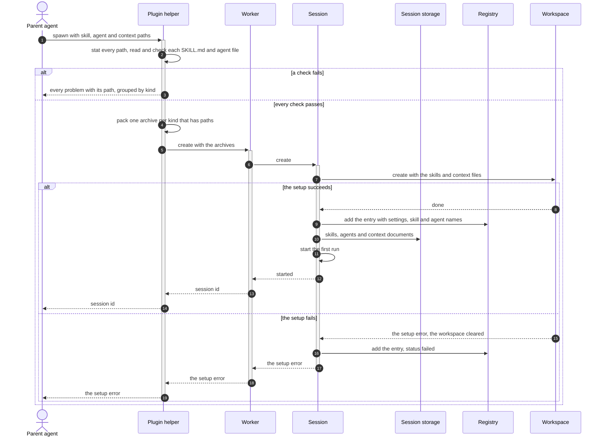
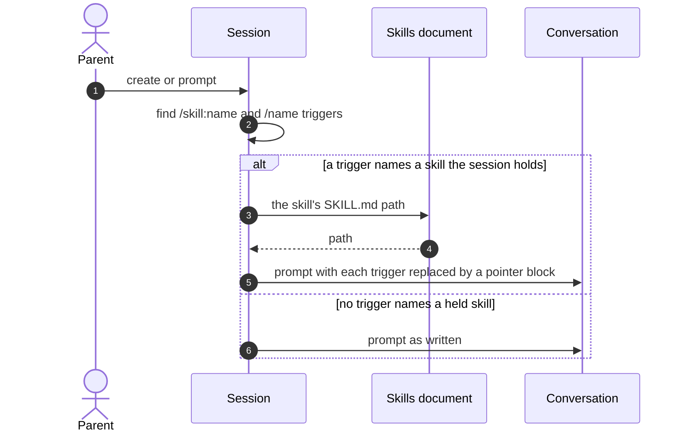
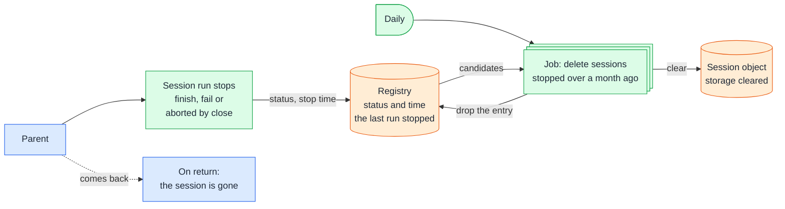

# Sessions

## 🔭 Overview

A session is one remote agent: a session object keyed by its session id, where pi-durable keeps its conversations and tentacles keeps a record of who started it, with which settings, and in what state it is. The registry keeps one entry per session so the list call returns a parent's sessions with their status in one call. At spawn, a session sets up its workspace and then starts running; a failed setup leaves only its registry entry, marked failed. It goes idle or failed when a run stops, waits while its agent asks a question, and stays readable after it is closed. A session also carries the skills and agent definitions its parent sent at spawn, which its agent finds by name, and the context files, which sit in `/workspace/context`. A daily job deletes every session whose last run stopped more than a month ago, and the delete call deletes one session at any time.

## 🗺️ A session from spawn to deletion



The parent spawns with a name, a first prompt, its settings and any skill, agent and context paths (1). The plugin checks the files and packs them into up to three archives (2), and sends create through the Worker to a new session (3, 4). The session creates its workspace with the repository and the files of the skills and context archives, which the workspace writes into `/workspace` while it clones (5), and the workspace reports success or hands back the setup error (6). The session adds its registry entry (7) and stores its record and its skills, agents and context documents (8), then answers with its id once the first run has started (9). When the setup fails, the session stores nothing, marks its registry entry failed and answers with the setup error ([workspace](workspace.md)).

In every run, the session expands any skill the prompt names (10), sends the conversation to the model (11, 12) and runs the tools the model calls in the workspace (13, 14). When the agent asks the parent, the session waits, the plugin wakes the parent with the question and the answer continues the run (15 to 19; [question-round-trip](question-round-trip.md)).

When a run ends, the session records the new status and the time the run stopped in the registry (20), and sends the state with the run's last entry, which the plugin turns into a wake (21, 22). A prompt starts a new run and close stops the session (23, 24; [worker-api](worker-api.md)). A month after the last run stopped, the daily job deletes the session (see Daily cleanup below).

## 💽 Modeling



pi-durable's conversations (the root, its forks and subagent conversations) live inside the session object as pi-durable stores them. tentacles adds the other entities.

### 🧠 Session

SESSION is the record each session object keeps next to pi-durable's history. `id` is the session id the object is keyed by. `name` is required and given by the parent at spawn; it is what the parent's status line shows. `parent_harness` (pi or claude) and `parent_session_id` identify the parent: its harness and that harness's session id. `settings` holds what the parent chose at spawn, with the plugin's defaults for anything the parent left out: provider, model, effort level, image and size, and optionally the repository tentacles clones into the workspace. close sets `closed`, and a prompt that reopens the session clears it. `last_stopped` is the time the session's last run stopped, and is empty while the first run is going.

The session state it sends the parent also carries its settings and the names of its skills and agents.

The session's status is not a field. The session object watches pi-durable's state and derives it: a run going is running, an unanswered question is waiting, no run with `closed` set is closed, no run with the last run's failure recorded is failed (pi-durable keeps why the run failed), and no run otherwise is idle. Each time the derived status changes, the session reports it to the registry and sends the session state to the parent, so a status always follows something the session did.

> [!NOTE] Why a failed setup leaves only a registry entry
> pi-durable records a failure only when a run ends, and the setup fails before any run exists. The session writes no record before the setup succeeds, so a failed setup leaves no session to recover: the parent gets the error, the registry entry reads failed, and every other call on it answers that the session is not found. That entry is the one status that does not come from pi-durable.

### 📒 Registry entry

REGISTRY_ENTRY lives in the registry, one for the whole deploy, with one entry per session: the session id, its name, the parent's harness and session id, the session's status (the same values as the session's derived status, closed included, and empty until the session reports its first one) and `last_stopped`, the time the last run stopped. When the session adds its entry at create, it also writes three values that never change: `settings`, and `skill_names` and `agent_names`, the names of the skills and agent definitions its spawn sent, which it reads from the archives. The registry records `last_stopped` itself when a status change reports a stopped run, keeps it when one stopped status follows another, and clears it when a new run starts. When the setup fails, the session adds the entry and then sets its status to failed, through the same call that records every status, so the entry counts as the session's last stop and the daily job deletes it a month later like any other session. The session updates its entry on every state change, so the list call and the plugin's start-up sync get each session's status without asking each session. The daily cleanup job picks its candidates from the registry's `last_stopped`, and drops the entry after it deletes the session; the delete call drops the entry the same way.

`preview_port` and `preview_token` hold the session's preview while one is open, and are empty otherwise. A session has at most one preview, and only to validate the app in the preview's browser; the agent validates anything else, such as an API, inside the workspace with no preview. `preview_port` is the workspace port the preview exposes. `preview_token` is a random UUID that the registry generates when the preview tool opens a preview. It is the only value the registry returns for the new preview, so a preview URL carries neither the API key nor the session id. Opening a preview while one is open replaces it: the previous token stops working and its browser closes. When the run stops, the registry clears both fields. [workspace](workspace.md) covers how the agent opens and uses a preview.

> [!TIP] Rejected: listing the session objects directly
> The session host reaches a session only by its id, and session objects cannot be enumerated or queried across instances, so "the sessions of this parent" has no answer without a store that spans sessions. The registry is that store, and holding the status there spares the plugin one status call per session.

### ❓ Question

QUESTION is a question the session's agent asked with `ask_parent`: its id, its text and its answer, empty until the parent answers. Every question of the session lives in one session-wide document, one entry per question, and an entry stays after its answer. The id is the id of the asking tool call. When an eviction makes the tool run again, the replay finds its question in the document and keeps the id. If the answer already arrived, the replay returns the answer without asking again. The waiting question is the one with no answer whose tool call is still live; an aborted or finished call takes its question out of waiting. [question-round-trip](question-round-trip.md) follows the question to the parent and back.

### 📚 Skills and agents documents

A skill is a folder that holds a SKILL.md and whatever the skill points to. An agent definition is a file whose frontmatter names a subagent and whose body is that subagent's prompt. The skills document and the agents document are pi-durable documents of the session, written once at spawn. A skill entry holds the skill's name and description, which the prompt lists. It also holds the full path of its SKILL.md in the workspace, which the skill tool and a prompt expansion point the agent to. An agent entry holds the agent's name, description and prompt, which the subagent tool starts a subagent with. Agent definitions live only here and never enter the workspace.

The session keeps no archive. It decompresses every archive once at create, to build the documents, and hands the files of the skills and context archives to the workspace's create, which writes them into `/workspace/skills` and `/workspace/context` once, at spawn. The agents archive goes no further, since agent definitions never enter the workspace. Deleting the session clears the documents, the workspace and the rest of its storage.

CONTEXT_DOCUMENT records whether the spawn sent context files, so the prompt section renders without reading the workspace. The session state, the list and the registry entry carry nothing about the context.

The API key and the Claude and GitHub credentials are Worker secrets, and none of these entities stores them.

## 🟢 Lifecycle



A session starts running when the parent spawns it, since spawn carries the first prompt; the session stores the skills and agent definitions and sets up its workspace before the run starts. When the setup fails, no session starts: the workspace clears what it wrote, the session stores no record, and the parent gets the setup error. Only the registry entry stays, marked failed, so the parent's list shows it. A prompt, answer, status or messages call on that session answers that the session is not found. The daily job deletes the entry a month after the failure. While it runs, a prompt from the parent follows up or steers. An eviction is not a state: pi-durable resumes the run by the session's alarm and the session stays running.

When the agent asks a question, the session waits. The conversation cannot continue until the parent answers. A prompt sent meanwhile is a steer whatever its mode, and reaches the agent after the answer; it neither answers nor cancels the question.

A run ends in one of two ways. When it finishes, the session is idle. When a model call fails with an error that pi-durable reads as transient, such as a lost Claude call ([claude-container](providers/cloudflare/claude-container.md)), pi-durable retries the call after 2, 4 and 8 seconds, and the run keeps its conversation and resumes from the step that failed. When the run fails on an error it cannot recover from, or on a transient one that still fails after the third retry, the session is failed: it behaves like idle and records why the last run failed. The plugin notifies the parent either way, and a prompt on either starts a new run. The session's preview, if one is open, closes when a run stops.

close aborts whatever the session is doing and leaves it closed: kept in its session object, where its history and state stay readable until it is deleted. close sets `closed` and aborts any run; the status turns closed once the session sees no run and `closed` set, at once for an idle or failed session. A prompt on a closed session clears `closed` and starts a new run, whether sent as a follow-up or a steer, and the status leaves closed once the run starts.

The month before deletion counts from when the last run stops: when it finishes, fails or is aborted by close. Closing a session that is already idle or failed aborts no run, so its month keeps counting from when its last run stopped. The daily job never deletes a session while a run is going, including while a question waits inside it, and reading a session (its messages, its status, a socket connecting) does not renew the month.

## 🧩 Skills and agents

### 🏗️ Which conversations get them

```mermaid
flowchart LR
    subgraph root["Root conversation"]
        R1@{ shape: rect, label: "Workspace tools,<br/>codemode, preview" }
        R2@{ shape: rect, label: "Skills extension<br/>document, section, skill tool" }
        R3@{ shape: rect, label: "Agents extension<br/>document, section, subagent tool" }
        R4@{ shape: rect, label: "Root extension<br/>question tool, tentacles instructions" }
    end
    subgraph child["Child"]
        C1@{ shape: rect, label: "Workspace tools,<br/>codemode, preview" }
        C2@{ shape: rect, label: "Skills extension" }
        C3@{ shape: rect, label: "Agents extension" }
    end
    subgraph grand["Grandchild"]
        G1@{ shape: rect, label: "Workspace tools,<br/>codemode, preview" }
        G2@{ shape: rect, label: "Skills extension" }
    end
    root -->|"spawns, keeps all but the root extension"| child
    child -->|"spawns, also drops the agents extension"| grand
    classDef green fill:#dcfce7,stroke:#16a34a,color:#1f2937
    classDef amber fill:#fef3c7,stroke:#d97706,color:#1f2937
    class R1,C1,G1 green
    class R2,R3,R4,C2,C3,G2 amber
```



Skills and agents are each one pi-durable extension that owns its document, its prompt section and its tool. Every conversation in a session gets the skills extension: the root, its children and their children. The root and its children also get the agents extension, so a child can spawn subagents of its own; a grandchild cannot. Only the root carries the question tool and tentacles' own instructions. An extension leaves its section out of the prompt when the section has nothing to list.

> [!NOTE] Why skills and agents are extensions of their own
> Only the skill tool, the subagent tool and their sections read the skills and agents, and they never change after spawn, while the session record gets a new revision at every run end. A document owned by each extension keeps them out of the record's revisions and lets either extension be taken out without touching the record.

### 🚀 What a spawn sends

The parent passes skill folder paths, agent definition paths and context paths to the spawn tool, on pi and on Claude Code alike. The plugin's helper stats every path, reads only each skill's SKILL.md and each agent definition file, checks them, and packs up to three archives, each a gzip-compressed tar file of at most 5 MB:

- The skills archive holds one folder per skill at its top level: `<name>/SKILL.md` and everything beside it.
- The agents archive holds one agent definition file per agent at its top level, named `<name>.md` after the agent.
- The context archive holds one entry per context path at its top level (see Context files).

The helper's packer reads the files while it packs. It follows symlinks and packs what each one points to, writes an entry for every folder, and keeps each file's permission bits, so a skill's executable scripts stay executable in `/workspace/skills`. A skill's SKILL.md goes into the archive as the helper read it, with its frontmatter repaired, in place of the file on disk. The helper checks each archive's size once the archive is packed.

Each archive is optional, and a spawn sends any of them without the others. The create call carries them next to the name, the parent, the settings and the first prompt (see [worker-api](worker-api.md)).



The helper checks each kind apart, every path on its own, and keeps going after a problem so it reports them all. A skill follows the Agent Skills specification. Its name is 1 to 64 lowercase letters, digits and hyphens, with no leading, trailing or doubled hyphen, and equals its folder's name. Its description is 1 to 1024 characters. An agent definition is a file whose frontmatter name and description follow the same rules as a skill's, whose name equals the file's name without `.md`, and whose body is not empty. Names are unique within each group, and each packed archive stays within 5 MB; a kind with a problem is not packed, so its size is not checked. When anything fails, the spawn tool returns every problem with its path, in a Skills, an Agents and a Context group, and nothing reaches tentacles.

Frontmatter is read as YAML. A top-level value on one line that YAML rejects as written, such as a description holding `: `, is read as a quoted string. The helper then packs the file with that value quoted, so the session reads valid frontmatter. Frontmatter that is still not valid YAML is a problem with its path.

> [!NOTE] Why a rejected value is read as a quoted string
> Definitions written for other assistants often carry such values, and those assistants accept them. Reading them as quoted strings keeps those definitions usable without editing them.

The session takes these values from an agent definition:

| From the file | Becomes |
|---|---|
| frontmatter `name` | the agent's name, verbatim |
| frontmatter `description` | the agent's description, verbatim |
| the body | the agent's prompt, verbatim, without the frontmatter |
| any other frontmatter field, such as tools, model, skills, color or permissionMode | nothing |

Every subagent gets the session's model and the tools of its level in the session, whatever its definition declares.

### 📩 How the archives move

#### 🧳 At spawn



The parent calls the spawn tool with paths (1). The plugin's helper stats every path and reads and checks each SKILL.md and agent definition file (2). On any failure, the helper returns every problem as the spawn tool's result and sends nothing (3). Otherwise it packs one archive for each kind that has paths (4) and sends create with them (5), which the Worker hands to the session (6). The session reads every archive again, decompressing each once; when it cannot read one or more, create returns one error that names each invalid archive and its problem, and the session stores nothing (see [worker-api](worker-api.md)). It creates its workspace with the files of the skills and context archives (7), which the provider writes into `/workspace/skills`, one folder per skill, and `/workspace/context`. When the setup succeeds (8), the session adds its registry entry with the settings and the skill and agent names it read (9), builds the skills and agents documents and writes the context document (10), starts the first run (11), and create answers with the session id once the run has started (12 to 14). When the setup fails, the workspace clears what it wrote and hands back the setup error (15), the session adds its registry entry with the failed status and stores nothing else (16), and create answers with the error (17 to 19).

> [!NOTE] Why the archives travel in create
> Only the workspace's setup needs the skills and context files, and it runs once, at spawn. The session decompresses each archive once, for its own checks and documents, and hands the same files to create, so no archive is decompressed twice.

#### 💬 In a prompt that names a skill



The session expands every prompt, the first one included, before the conversation admits it (1, 2). `/skill:<name>` and `/<name>` name a skill when the word after the slash is one of the session's skill names and the trigger stands on its own, with whitespace or the start or end of the text on each side. For each one, the session takes the skill's path from the skills document (3, 4) and replaces the `/skill:<name>` or `/<name>` in place with a block that points at the skill (5); a skill named twice gets a block at each one. A prompt with no such name reaches the conversation as written (6), and so does any `/word` that names no skill, sits inside a path or has punctuation attached. The conversation keeps the expanded prompt, so the session's messages show what the agent saw.

The prompt "Run /implement on the api repo" reaches the agent as:

```text
Run <skill name="implement" location="/workspace/skills/implement/SKILL.md">
Read /workspace/skills/implement/SKILL.md before acting on this skill. Paths it names, such as references/ or scripts/, are relative to /workspace/skills/implement/.
</skill> on the api repo
```

> [!NOTE] Why the block points at the skill instead of holding it
> The agent reads SKILL.md with its read tool when it acts on the block, the same way it reads the files the skill refers to. The block stays a few lines whatever the skill's size, and expanding a prompt reads nothing but the skills document.

### ♠️ What they expose

| Member | Answers | Who asks |
|---|---|---|
| skills section | each skill's name and description, and that the skill tool loads one | the model, in every conversation, when the session holds skills |
| skill tool | given a skill name, the same pointer block a prompt expansion adds; an unknown name fails the call, naming the skills that exist | the model, when a task matches a listed skill |
| agents section | each agent's name and description, and how to spawn one with the subagent tool | the model, in the root and its children, when the session holds agents |
| subagent tool, run and spawn | an optional agent name: with one, the subagent starts with that agent's prompt as its instructions; an unknown name fails the call, naming the agents that exist | the model, in the root and its children |

Without an agent name, run starts the subagent with no instructions of its own, and spawn starts it with a line giving the subagent's name.

When a subagent's input ends unanswered, pi-durable settles it with a reason (`aborted`, or the failure's code such as `model_error`) and, for failures, the error's message. run fails with `The subagent did not answer: unanswered (<reason>)`. pi-durable first retries a subagent's lost Claude call the same way, so the subagent's input ends unanswered with `model_error` only once the retries are spent. A spawned subagent's reporter posts `[subagent <name> stopped: aborted]` or `[subagent <name> failed: <reason>]` to the parent, and wait returns that same text.

> [!WARNING] A skill that names a skill the session does not hold
> Skills often load other skills by name, sometimes with a plugin prefix such as `plugin:skill`, and refer to their own files through variables such as `${CLAUDE_PLUGIN_ROOT}`. tentacles resolves neither. The model works them out from the listing and the `/workspace/skills/<name>/` layout, and a skill the parent did not send is missing: the agent finds no such name and carries on without it.

## 📎 Context files

The parent can send files and folders that the repository does not hold, such as a change's scratch files. They travel the way the skills do: a spawn parameter, an archive the plugin packs, and the archive's files written into the workspace at spawn. They land in `/workspace/context`, next to `/workspace/repo` and `/workspace/skills`.

- **Where the files land.** The parent passes `context`, a list of file and folder paths on its machine. Each path lands under its basename: a file at `/workspace/context/<file name>` and a folder at `/workspace/context/<folder name>/…`. Two paths with the same basename fail the spawn. How the helper checks and packs the paths, how create reads the archive and how the setup writes its files are in What a spawn sends and How the archives move.
- **What the agent sees.** When the spawn sent context, every conversation's prompt carries a context section that says the parent sent files for context and that they are in `/workspace/context`. It names the folder only, not its entries, and without context there is no section. The agent reads the files with the workspace's tools.
- **What stays outside.** `/workspace/context` is outside the repository. What the agent changes there stays in the workspace for the session's life and never returns to the parent. A different set of files means a new session. Deleting the session deletes the files with the rest of the workspace.

## 🧹 Daily cleanup



A job runs once a day through the `Scheduler` contract (see [runtime-components](runtime-components.md)). It reads the registry and picks the sessions whose last run stopped more than a month ago. A running or waiting session is never a candidate. For each candidate it deletes the session through its session object. The session object deletes the session's workspace with every file in it, then clears its own storage, which removes its history, its record and its skills and agent definitions. The job then drops the registry entry. The entry goes only after the session is gone, so a deletion that stopped halfway leaves the session a candidate, and the next day's job deletes it again and drops the entry. No preview is left by then, since the preview closes when a run stops. Nothing outside tentacles is touched: branches the agent pushed stay on GitHub, and work it never pushed is gone with the workspace.

The delete call does for one session what the job does for each candidate: it deletes the session through its session object, which stops a run that is going, deletes the workspace and clears its own storage, and then drops the registry entry. It answers with no content, and answers that the session is not found when the registry has no entry for the id. It accepts a session in any state: running, waiting, idle, failed, closed, or one whose setup failed, which has no record and only an empty workspace to delete. A deletion that fails answers an error and keeps the entry, so the caller sends the call again, and the next daily job also finds the session if it is a candidate. Once the call answers, the session is gone: every call on its id answers that the session is not found, and the list no longer shows it.

tentacles does not tell the parent. The parent's plugin removes the session from its local list the first time it learns of the deletion (see [plugin](plugin.md)).

The session's wake-up timer belongs to pi-durable, which uses it only to resume a run after an eviction. Nothing else schedules on it.

> [!TIP] Rejected: scheduling each session's deletion on its own wake-up timer
> A session has one wake-up timer, and pi-durable writes it and deletes it as runs start and end: after a run ends, the host clears it, and a new instance replaces it. A deletion written to the same alarm would be lost the first time a run stopped, and the alarm handler could not tell a due deletion from a resume. A daily job over the registry keeps the two apart.

---

Related: [runtime-components](runtime-components.md), [worker-api](worker-api.md), [question-round-trip](question-round-trip.md), [workspace](workspace.md), [plugin](plugin.md), [remote-agents](../product-design/remote-agents.md)
