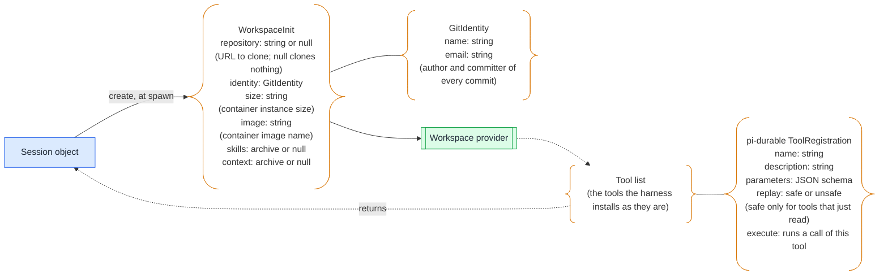
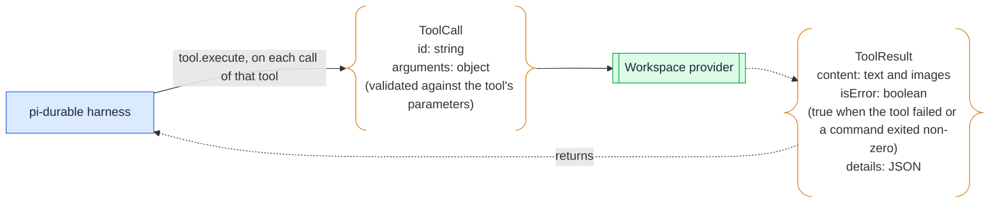
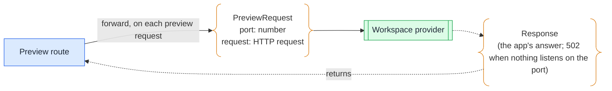
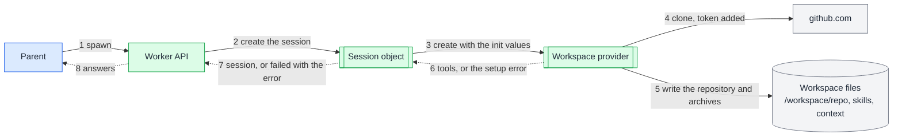
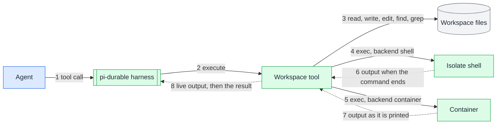
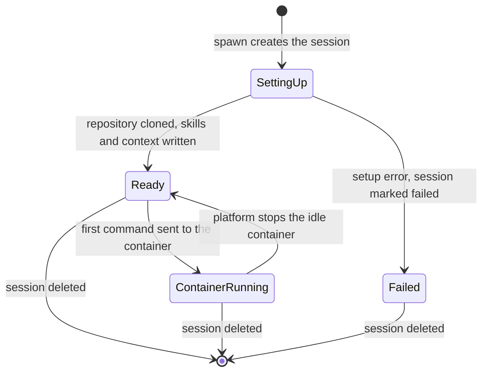
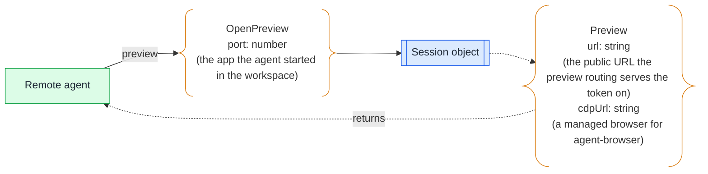

# Workspace

## 🔭 Overview

Each session has one workspace, which the session object creates at spawn through the `Workspace` contract. The provider sets it up before the session's first run: it clones the session's repository into `/workspace/repo` and writes the skills and context the parent sent into `/workspace/skills` and `/workspace/context`. It hands back the tools the agent works with, and each environment defines its own. The workspace's files live with the session: a container that stops keeps them, and deleting the session deletes them. The agent gets a browser only to validate a preview of the app it started.

## 📜 The workspace contract

The contract has two members that core calls, `create` and `forward`, and the tools `create` returns, whose `execute` only the harness calls. Nothing else about the environment crosses it: no execution environment, no start, stop or keepalive, no egress setting.

`create` · at spawn

`tool.execute` · on each call of that tool

`forward` · on each preview request

The session object creates the workspace at spawn with where to clone from, who commits, the container's size and image, and the skills and context archives the parent sent. A null repository means the session has no repository: the provider creates the folders and clones nothing. A null archive means the parent sent no skills or no context, and its folder stays empty. The repository, size and image come from the session's settings, the archives from the spawn and the identity from the deploy. The image is a name whose meaning each provider defines.

`create` returns a list of pi-durable tool registrations, each with its declaration, its replay policy and its own `execute`, and core installs them as they are. The provider sets each tool's replay: safe for tools that only read, unsafe for the rest, so after an eviction pi-durable reruns only the tools that change nothing. A tool's `execute` takes one call's arguments and returns its result. It sets the error flag when the tool fails or a command exits with a non-zero code, and carries the exit code and the output in the content.

`forward` hands a preview request to a port in the workspace and returns the app's answer, or 502 when nothing listens there.

> [!NOTE] Why the contract returns pi-durable tools
> The tools an environment offers depend on what it can run, so each provider writes its own and core does not translate between them. The contract depends on pi-durable's tool type the same way `SessionStorage` depends on pi-durable's storage.

## 📥 Inputs from the session's settings

| Input | What it is | When absent |
|---|---|---|
| image | the container image: `default`, the only image tentacles offers; create rejects any other | `default` |
| size | the container's instance type | standard-2 |
| repository | an `https://` (or `http://`) repository URL and a shallow-or-full clone flag; create rejects any other URL form | nothing is cloned |

The plugin fills every absent value except the repository from its defaults, which environment variables can change, so the session always holds a full set (see [worker-api](worker-api.md)).

## 🧳 Setup at spawn

The parent spawns (1) and the Worker API creates the session (2), which creates the workspace with the init values (3). The provider clones the repository's default branch into `/workspace/repo`, shallow or full as the setting says, with the GitHub token added outside any container (4). It writes the repository and the skills and context archives into the workspace's files (5): the skills into `/workspace/skills`, one folder per skill, and the context into `/workspace/context`, each file or folder under its own name. It hands back the tools, or the error that stopped it (6). The session answers with itself, or marks itself failed and answers with the error (7), and the Worker API answers the parent (8). Only then does the first run start.

The setup is part of the session's initialization, so it runs once per session, and the three folders exist before the agent's first tool call. Without a repository setting, the agent clones whatever its prompt names.

A failed setup's error names the known causes in plain words: a repository URL that does not exist, a token that cannot read the repository, GitHub not answering, or an archive that cannot be expanded. Any other error is returned as it was captured. The session keeps the setup error in its record and its status reads failed, with the error as the failure's detail; its first run never starts and it has no workspace to use (see [sessions](sessions.md)).

> [!NOTE] Why the setup runs at spawn
> A setup that runs inside the first tool call fails in the middle of a run, where only the agent sees it. Running it before spawn answers puts the cause in front of the parent, which can fix the repository URL or the files and spawn again.

## 🧰 The agent's tools

The agent calls a tool (1) and the harness runs that tool's `execute` (2). File tools work directly on the workspace's files (3). The command tool runs on the backend the agent names: the isolate shell (4) or the container (5). The shell hands back its output when the command ends (6); the container streams output as it is printed (7). The tool passes output to the harness's live view as it arrives, then the result with the exit code (8). The agent's instructions name `/workspace/repo`, `/workspace/skills` and `/workspace/context`.

The agent chooses where each command runs, through the tools. Each operation runs on the cheapest place that can do it: the session object for files and git, then the isolate shell, and the container only when the work needs it. The provider writes the description of each backend the agent picks from, so the text matches what that backend can run.

| Tool | What it does |
|---|---|
| the workspace's tools | whatever `create` returned: file tools and a command tool that takes the backend to run on; their names are the environment's own ([computer-workspace](providers/cloudflare/computer-workspace.md) lists Cloudflare's) |
| codemode | runs a script that calls the other tools by name except `ask_parent`; scripts keep `models.*` (the model catalog, classify and generateImages) through the session's providers |
| subagent | starts a subagent in the foreground, returning its answer, or in the background, to spawn, steer, stop and list; run and spawn take an optional agent name, and the subagent then starts with that agent definition's prompt. The root and its children have the tool, so a child can start subagents of its own; a grandchild cannot |
| skill | given the name of one of the session's skills, returns a block pointing at its SKILL.md in `/workspace/skills`, which the agent then reads; an unknown name fails, naming the skills that exist |
| ask_parent | asks the parent; root conversation only, and only the model calls it (see [question-round-trip](question-round-trip.md)) |
| preview | opens a preview, returning a preview URL to a workspace port and a CDP URL to a browser and replacing the open preview if there is one; or closes the open preview |

Core installs the workspace's tools as one harness extension, in place of pi-durable's coding tools. codemode is pi-durable's own tool and runs in the `CodeSandbox`. pi-durable ships no subagent tool, so tentacles writes one following pi-durable's examples. The subagent tool and the skill tool each belong to an extension of their own, described in [sessions](sessions.md); a subagent never gets `ask_parent`.

The model reads each tool's result as text. Only the model calls `ask_parent`: a script's tool call runs as a nested task, which the session does not watch when it derives its status, so a question asked from a script would never show the session as waiting. preview also returns a tagged structured result to a program that calls it, such as a codemode script: `open` with the preview URL and the CDP URL, or `close`.

agent-browser is not part of tentacles: the agent installs it and runs it in the container through the command tool.

## 🪪 Who the agent's commits are by

```mermaid
flowchart LR
    O(["Operator"]) -->|"1 sets author name and email"| V[("Deploy variables, required")]
    V -->|"2 deploy fails when either is missing"| W["Worker"]
    W -->|"3 hands both to the session object"| S["Session object"]
    S -->|"4 create, with the identity"| P["Workspace provider"]
    P -->|"5 sets it on every git route"| C["Agent's git commits"]
    classDef ext fill:#f3f4f6,stroke:#6b7280,color:#111827
    classDef mod fill:#dcfce7,stroke:#16a34a,color:#14532d
    classDef store fill:#ffedd5,stroke:#ea580c,color:#7c2d12
    class O ext
    class W,S,P,C mod
    class V store
```

The operator sets an author name and an email as two deploy variables, `TENTACLES_GIT_AUTHOR_NAME` and `TENTACLES_GIT_AUTHOR_EMAIL` (1). Both are required, and a deploy without either fails (2). The Worker hands both to each session object (3), which passes them to `create` as the git identity (4). The provider sets the identity on every git route the agent can commit through, so every commit carries the deploy's identity as author and committer, whatever the session's provider (5). The contract does not depend on the variables' names.

The agent cannot change the identity, and its instructions do not mention it. The name and email are not credentials, so passing them into a container keeps the rule that credentials stay out of containers (see [runtime-components](runtime-components.md)).

## 🟢 The workspace's lifecycle

The provider sets up the workspace at spawn, and its files live with the session from then on. The container starts on the first command sent to it, and the provider stops it when it has been idle; core never starts or stops it. A stop keeps `/workspace` and loses the running processes and anything outside `/workspace`, which is the container's own disk. A failed setup leaves the session failed, with no workspace to use. Deleting the session deletes the workspace, unpushed work included, and only branches the agent pushed outlive it.

> [!NOTE] Why tentacles does not check for unpushed work
> The workspace's files live with the session, so a container stop loses no work, and work is lost only when the session is deleted a month after its last run. A provider whose workspace can lose files on a stop protects them itself.

## 🖼️ The preview and the browser

A session has at most one preview, and only to validate the app in a browser. When the agent wants to check the app it started in the workspace, it calls the preview tool with the app's port. The tool runs in the session object, which opens a browser through the `Browser` contract. The registry then generates a token, records it and the port on the session's entry and returns the token. The tool returns two URLs: the preview URL, which `PreviewRouter` builds from the token alone, and the browser's CDP URL, which carries a token signed with a deploy secret. The agent points agent-browser at the CDP URL, opens the preview URL, validates what it built and closes the preview. Closing the preview clears its token, so the preview URL stops working. It also closes the preview's browser.

When the agent calls the preview tool while a preview is open, the new preview replaces it: the previous token stops working and its browser closes.

Anything that is not the app the browser opens, such as an API or a backend, the agent validates inside the workspace with the command tool, with no preview.

Requests to the preview URL reach the preview route, which looks up the token in the registry and hands the request to the session's object, which passes it to the workspace's `forward` with the token's port. [preview-and-browser](providers/cloudflare/preview-and-browser.md) covers how Cloudflare routes the preview and the browser's CDP traffic.

A preview lives only within a run. The browser closes with its preview, when the agent closes the preview or when the run stops by finishing, failing or close. The registry then clears the preview from the session's entry. A later run opens a preview again if it needs one.

---

Related: [runtime-components](runtime-components.md), [sessions](sessions.md), [question-round-trip](question-round-trip.md), [worker-api](worker-api.md), [computer-workspace](providers/cloudflare/computer-workspace.md), [preview-and-browser](providers/cloudflare/preview-and-browser.md)
