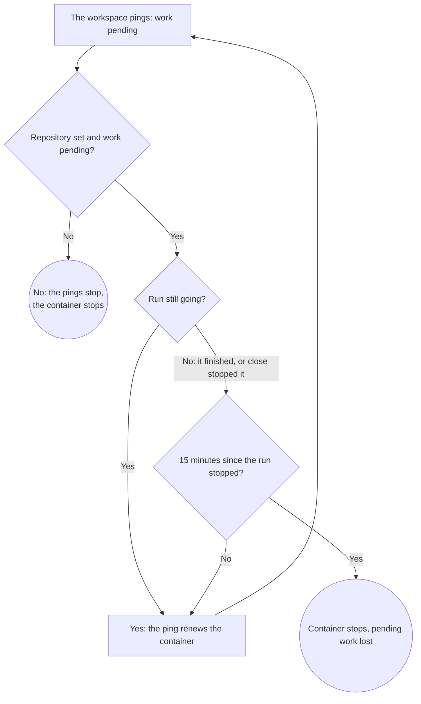
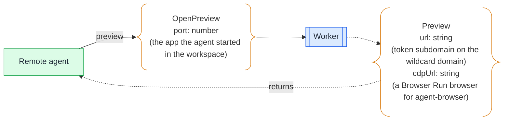

# Workspace

## 🔭 Overview

Each session has one workspace container, started at the first tool call that needs it, from the image, size and lifetime in the session's settings. The agent works in `/workspace`, where tentacles clones the session's repository when the settings name one. The disk is disposable: work survives only once it is committed and pushed, so tentacles holds the container up and prompts the agent while a managed repository has pending work. The agent's tools run in the container through pi-env, and the agent gets a browser only to validate a preview of the app it started.

## 📥 Inputs from the session's settings

| Input | What it is | When absent |
|---|---|---|
| image | the container image | the default image |
| size | the container's instance type | basic |
| lifetime | inactivity time before the container stops | 15 minutes |
| repository | a repository URL and a shallow-or-full clone flag | nothing is cloned |

The plugin fills every absent value except the repository from its defaults, which environment variables can change, so the session always holds a full set (see [worker-api](worker-api.md)).

## 📦 What the container holds

The default image holds only what tentacles needs: pi-env's daemon, git and CA certificates, with git set up to authenticate through the token added at egress, and a small process that pings the session with busybox `wget` to keep the container up while work is pending (see below). It has no Node, no Chrome and no Docker. The agent installs anything else it needs, or a client builds its own image and names it in the settings.

The agent always works in `/workspace`. Before every tool call, tentacles makes sure the workspace is up. When the container is not running, tentacles starts it and waits until it is ready. When the settings name a repository, tentacles then clones the repository's default branch there, shallow or full as the setting says. The first tool call and the first one after a restart, even in the middle of a run, find the repository in place. Without a repository setting, the agent clones whatever its prompt names. git reaches GitHub with the GitHub token added at egress; the container never holds it (see [runtime-components](runtime-components.md)).

## ⏱️ Lifetime and pending work

The container starts at the first tool call that needs it and stays up while the session is working. Its lifetime is an inactivity time, 15 minutes by default, and every command run in the workspace resets it.

The workspace keeps itself up while it has pending work. A small process in the image checks `git status` in `/workspace` and, while work is pending, pings the session every minute; the session answers by the rule in the flowchart below, and answers no when the settings name no repository. Each ping that reaches the session renews the container. When the session answers no, the process stops pinging, and the inactivity time stops the container. The session schedules no check of its own, so pi-durable keeps sole use of the session's alarm. An image without the ping process, such as a client's own, stops after its inactivity time whatever is pending.

Pending work is anything in the session's repository that is not committed and pushed. tentacles checks for it only when the settings name a repository, since that is the only repository it manages. The check runs at three points: when the question tool asks (see [question-round-trip](question-round-trip.md)), when a run finishes, and whenever the workspace pings while it has pending work.

When a run finishes with pending work, tentacles prompts the agent to commit before the run ends, and the run goes on. It does so up to three times; after the third, the run finishes with the work still pending.

When the lifetime runs out with pending work during a run, tentacles keeps the container up and checks again. Once the run has finished, pending work keeps the container up for 15 more minutes only; then the container stops.

> [!WARNING] Pending work is lost 15 minutes after the run finishes
> If the agent ignores all three commit prompts, its uncommitted or unpushed work stays only on the container's disk. Fifteen minutes after the run finishes the container stops and the work is gone. The run finishes as any other run does, so a parent that expects a pushed branch should check for it.

tentacles sends the commit prompts when a run finishes and closes the preview when a run stops, however much lifetime is left.

Closing a session stops its run. Without pending work, the container then stops once its lifetime passes. With pending work, the container stays up for 15 more minutes after the close, then stops and the work is lost, as after a finished run.

## 🧰 The agent's tools

| Tool | What it does |
|---|---|
| read, write, edit | work on files in `/workspace`, through pi-env |
| bash | runs commands in the workspace; agent-browser runs through it |
| codemode | runs a script that calls the other tools; scripts keep `models.*` (the model catalog, classify and generateImages) through the session's providers |
| subagent | starts a subagent in the foreground, returning its answer, or in the background, to spawn, steer, stop and list; subagents have neither the question tool nor the subagent tool, so they do not nest |
| question | asks the parent; root conversation only; refuses while the repository has pending work |
| preview | returns a preview URL to a workspace port and a CDP URL to a browser, replacing the open preview if there is one |

The coding tools run in the container through pi-env: the session object reaches pi-env's daemon over the container's exec stdio. codemode is pi-durable's own tool; on Cloudflare it runs in a RemoteCodemodeSandbox. pi-durable ships no subagent tool, so tentacles writes one following pi-durable's examples, and that tool leaves the question tool and itself out of every subagent.

agent-browser is not part of tentacles: it is in the image or the agent installs it, and the agent runs it through bash.

## 🖼️ The preview and the browser

A session has at most one preview, and only to validate the app in a browser. When the agent wants to check the app it started in the workspace, it calls the preview tool with the app's port. The Worker generates a token, records it and the port on the session's registry entry, opens a Browser Run browser through the binding, and returns two URLs: the preview URL, `https://<token>-tentacles-preview.asermax.com`, which carries only the token, and the browser's CDP URL, which carries a token the Worker signs. The agent points agent-browser at the CDP URL, opens the preview URL, validates what it built and closes the preview.

When the agent calls the preview tool while a preview is open, the new preview replaces it: the previous token stops working and its browser closes.

Anything that is not the app the browser opens, such as an API or a backend, the agent validates inside the workspace with bash, with no preview.

Requests to the preview URL reach the Worker's preview route, which looks up the token and forwards to that port in the workspace. agent-browser's CDP traffic reaches Browser Run through the Worker's relay.

A preview lives only within a run. The browser closes with its preview, when the agent closes the preview or when the run stops by finishing, failing or close. The registry then clears the preview from the session's entry. A later run opens a preview again if it needs one.

> [!TIP] Rejected: a browser inside the workspace container
> Running Chrome in each workspace would put a browser in every image and keep it out of a client's own image unless they add it. Browser Run gives every session the same managed browser, opened by the Worker through the binding with no API token, and the default image stays small.

---

Related: [runtime-components](runtime-components.md), [sessions](sessions.md), [question-round-trip](question-round-trip.md), [worker-api](worker-api.md)
